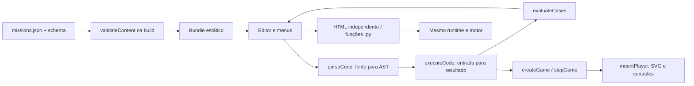

# Passo 002 — Arquitetura e baseline técnico

**Conferência:** 12/10/2026, America/Sao_Paulo. **Responsável pela execução:** Lucca Castilho, conta luccalck. **Escopo:** 002 / D01, D02, D04 / INT-04, INT-06, INT-03 / preparação G1. **Fonte executada:** `776a0a9210b36bf501e7fc2dc20fe592cf9c06b5`, versão 0.6.0. Não alteramos regras, missões, dependências ou workflows nesta etapa. G0/G1 e os integráveis completos continuam sem aceite final.

## Decisão e limites

Mantemos a oficina Python aprovada: cinco missões (controlar, mover, colidir, pontuar, criarOnda) e final integrado. A stack HTML/CSS/SVG/TypeScript/esbuild produz site estático e funciona no navegador sem engine instalada, backend, CDN ou serviço pago. O jogador escreve Python educativo; o navegador executa AST num interpretador próprio, não CPython completo. Isso conserva testabilidade, exportação e offline.

Produto é coordenado por Lucca; Desenvolvimento por Davi e Plataforma por Miguel, com participação compartilhada. Já temos concordância informada com os papéis no [registro da equipe](equipe.md). Entregamos os contratos abaixo para leitura/validação dos colegas; não registramos aprovação técnica ou autoria deles neste passo. Conteúdo e aprendizagem continuam sujeitos à revisão humana e playtest.

## Componentes e contratos

| Camada | Arquivo/interface | Contrato efetivo |
|---|---|---|
| Conteúdo | [missions.json](../../src/content/missions.json), [schema.json](../../src/content/schema.json), [validate.ts](../../src/content/validate.ts) | Seis missões, IDs únicos, ordem das cinco funções + final; 100 XP cada, 200 final. Ajv strict/allErrors com additionalProperties=false, seguido de validação semântica. |
| Entrada educativa | Mission / CodeCase em [arcade-engine.ts](../../src/core/arcade-engine.ts) | id, title, concept, goal, help, functionName, starter, reference, cases, reward. Casos contêm label/input/expected. Final não introduz sexta função, starter ou casos próprios. |
| Compilação | [code-parser.ts](../../src/core/code-parser.ts), [code-types.ts](../../src/core/code-types.ts) | parseCode(source, expectedName) retorna Program; nome/parâmetro entrada/indentação e subset validados. CodeError informa linha. |
| Avaliação | [code-runtime.ts](../../src/core/code-runtime.ts) | compileCode retorna Rule: Input → Value. Clona entrada/saída, sem eval, Function ou APIs remotas. Tipos: número, booleano, texto ou lista numérica. |
| Testes educativos | evaluateCases | Retorna expected/actual/ok/error por caso. Comparação e erros observáveis; passar casos não prova qualquer programa possível nem aprendizagem humana. |
| Motor puro | createGame(rules), stepGame(previous,input,rules) | Estado playing/won/lost/error, posição, vidas, pontos, onda e objetos. Sem DOM; clona estado anterior. Contratos inválidos encerram com diagnóstico. |
| Visual | [app.ts](../../src/scenes/app.ts), [arcade-player.ts](../../src/scenes/arcade-player.ts), views.ts | UI mantém home/missions/workshop, editor, teste e progresso. Player gerencia eventos e atualização20ms, renderiza SVG, pausa e dispose remove listeners/timer. |
| Persistência | [progress.ts](../../src/core/progress.ts), [workshop-save.ts](../../src/core/workshop-save.ts), preferences.ts | StoragePort injetável; chaves da oficina v5. Falha de armazenamento mantém sessão; reset preserva campanhas anteriores e outras chaves. |
| Exportação | [export.ts](../../src/scenes/export.ts), [code-print.ts](../../src/core/code-print.ts), [export-player.ts](../../src/scenes/export-player.ts) | Exige cinco regras passando casos; HTML recebe AST escapada e bundle do mesmo interpretador/motor. .py contém fontes e MIT; editar .py não recompila HTML. |

Nas missões1–5, somente a função estudada usa a fonte do jogador; as outras usam referências de apoio. Passar os casos libera a próxima. No final, cinco fontes precisam passar23casos e vencer uma partida atual com100pontos/trêsvidas. Editar invalida testes, pausa e impede retomar a regra antiga. Vitória/derrota/erro encerram o motor; replay/reinício têm contratos testados.

Controles devolvem -1/0/1; movimento um número finito limitado à arena pelo motor; colisão booleano; pontuação inteiro0..9999; onda devolve quantidade correta de posições únicas20..460. A validação semântica compara expected com regras educativas, exige variedade/fronteiras, referências corretas e starters com falhas.

Limites do interpretador: 6000caracteres,300nós, profundidade20,2000operações,64iterações por laço e listas64. Sem import, classes, while, chamadas livres ou propriedades arbitrárias. CPython nas unidades executa apenas fixtures editoriais confiáveis em processo com timeout; não executa fonte de jogador remotamente.

## Contrato de build e testes para Plataforma

- Node24 (`package.json`: >=24 <25), lockfile e `npm ci`; runtime local v24.15.0, npm11.12.1, Python3.12.10.
- `npm run lint`: ESLint + TypeScript sem emissão. `npm run test:ci`: Vitest/V8, JUnit e cobertura; thresholds agregados70% para instruções, ramificações, funções e linhas de src/core.
- `npm run build`: primeiro content:check; falha impede esbuild. Bundle IIFE com conteúdo local, player/exportação e licença incorporados.
- dist contém index.html, game.js, style.css, version.json, LEIA-ME.txt, LICENSE.txt e THIRD_PARTY.txt. SemVer vem de package.json; SHA vem de GITHUB_SHA ou Git; data vem de BUILD_DATE ou UTC. Tag divergente da versão falha. A tela recebe versão/SHA embutidos.
- `npm run test:e2e`: Playwright/Chrome com relatórios HTML/JUnit e capturas reais; suíte local não equivale a regressão formal HML ou smoke PRD. CI Ubuntu executa os mesmos comandos e arquiva relatórios.
- ZIP/checksum/PDF/reprodutibilidade são contratos existentes; promoção formal deve recuperar o mesmo artefato, sem recompilar. Nenhum deploy/release foi realizado nesta etapa.

## Execuções desta etapa

| Comando/ensaio | Resultado real |
|---|---|
| npm ci | exit0;158pacotes instalados,159auditados,zero vulnerabilidades informadas nessa execução |
| npm run lint | exit0 |
| npm run test:ci | exit0;152unidades +26integrações =178 testes, nove arquivos; duração3,75s |
| npm run build | exit0;6missões validadas; dist69139bytes, versão0.6.0/SHA776a0a9 |
| npm run build em cópia local com campo extra no JSON | exit1: `JSON inválido: /missions/0 must NOT have additional properties`; dist não criado |
| npm run test:e2e, primeira tentativa | falha ao iniciar webServer por `spawn cmd.exe EACCES`; nenhum sucesso declarado para essa tentativa |
| node scripts/dev.mjs + EXTERNAL_SERVER=1; npm run test:e2e | exit0;15cenários passaram em23,3s, incluindo campanha, toque390×844 e HTML/file:// sem rede |
| git diff --exit-code -- src tests scripts package.json package-lock.json vitest.config.ts | exit0; implementação preservada |

Cobertura V8 agregada: **instruções97,90% (468/478), ramificações95,23% (320/336), funções100% (54/54), linhas100% (128/128)**. Não alegamos70% por arquivo: code-print.ts tem66,66% de instruções e50% de ramificações; o threshold configurado é agregado.

Unidades: motor22; semântica/CPython16; parser/runtime74; preferências9; progresso19; fontes12. Integrações: conteúdo15; exportação5; Pages6. Os testes negativos existentes verificam carga inválida, campos extras, expected incoerente, referência/starter, IDs/ordem, casos/fronteiras e final. Não acrescentamos teste artificial ou bug inventado. Não encontramos defeito funcional reproduzido que justificasse alteração do jogo neste passo.

O ensaio negativo utilizou `.contexto/passo-002/conteudo-invalido`, cópia isolada de core/conteúdo/scripts, com node_modules compartilhado por junction local. Alteramos somente o JSON dessa cópia. Logs, metadados e relatórios locais foram preservados em `.contexto/passo-002`, ignorado pelo Git; não é outra fonte principal ou pacote final.

## Integridade das evidências locais

| Arquivo | SHA-256 desta execução |
|---|---|
| reports/junit.xml | c79232d430733333dce39f8e8e7c0465de2ecf803b79d1c2048ab7e1dc6632e8 |
| reports/e2e-junit.xml | 3e3a252eaee4f2321505c969c8854aeafb2e6d9682102246abd0ba230f6a51b3 |
| reports/coverage/coverage-summary.json | f6c74908e70c010143f7f1c1ffa5a1e59eb3b1008dc0bbde5d1746877375d67f |
| dist/version.json | cab60d6bd47d1375e61cae3c351fed007e21543cf1abc8e11a5f470e4fb5ce44 |

A data UTC do build é2026-10-13T02:49:17.143Z, correspondente a12/10/2026às23:49:17 em São Paulo. Relatórios podem ser sobrescritos em outra execução; copiamos os desta etapa para o contexto local. CI do PR fornece artefatos independentes do computador.

## Fontes e aceites pendentes

Conferimos o HTML integral/texto/script da ficha, modelo GDD, checklist/auditoria, GDD atual, README/SQUAD/políticas/IA/licenças, índice e D01/D02/D04. Originais com os mesmos hashes registrados em [equipe.md](equipe.md), preservados. Sem Godot, Opal ou AI Studio: ARQ-10 e golden eval específicos são condicionais não aplicáveis; não marcamos uso fictício.

SQ-07 continua pendente de validação/assunção técnica efetiva por Desenvolvimento; a coordenação foi acordada, mas não substituímos a participação de Davi. Contratos técnicos entregues para Plataforma/Miguel ainda precisam de leitura/validação humana. Revisão cruzada antes do merge, G0/G1, HML/PRD formal, final/release/offline e playtest permanecem pendentes nos passos correspondentes. [Registro único de pendências](../execucao/05-pendencias-por-passo.md). Não fechamos um INT inteiro ou atribuímos nota.

## Publicação da preparação

Commit próprio `b79828ca6dacb9e32f7995ad905ea0bff9705428`, identidade Git/GitHub luccalck conferida antes da gravação; [PR#4](https://github.com/luccalck/desafio-arcade/pull/4) em rascunho sobre feature/passo-001-equipe-contexto, sem merge. A base intermediária isola002, pois001 e o PRprincipal#2 ainda aguardam integração na main. CI38339152555 acionada por push; seu resultado e o do último HEAD precisam ser conferidos, não inferidos.

A primeira gravação de dois arquivos administrativos no índice manteve CRLF e `git diff --cached --check` apontou whitespace; o comando de commit continuou indevidamente. Corrigimos para LF na atualização seguinte, preservando alterações locais anteriores separadas do índice. Não representar a primeira checagem como aprovada. Gitleaks do primeiro commit não detectou vazamentos.
