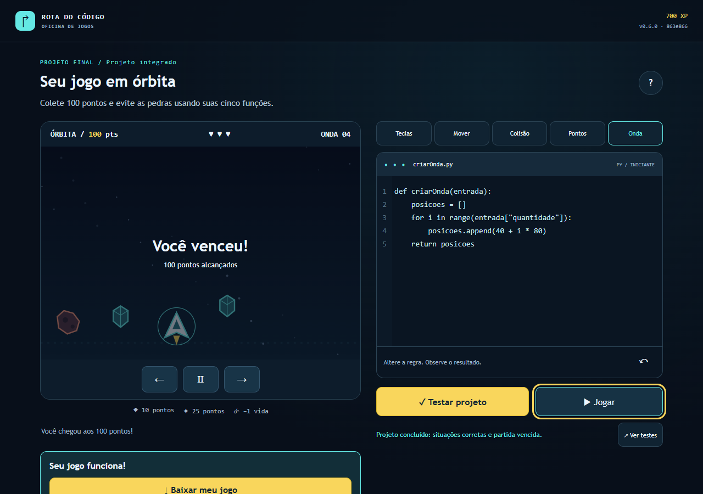

# Bug real — download Python após vitória

D06/INT-04,12/10/2026. Na fonte863e866, vencer o final montava uma recompensa diferente da exibida ao reabrir a tela: faltava o botão Minhas funções.py e a legenda ainda dizia JavaScript. Teste de campanha chegou à vitória700XP, mas click/download.py não pôde ocorrer e terminou por timeout120s. JUnit e captura abaixo são da execução real anterior, não reconstruídos.

[JUnit anterior](bug-download-py-antes.junit.xml). As referências de trace temporário são do diretório original; não inventar disponibilidade de anexos ausentes.

Correção5ebdc64: src/scenes/views.ts exporta projectReward, usado pelo callback da vitória em app.ts e pelo workspace. Uma fonte de markup produz ambos os botões imediatamente. Regressão de campanha baixa.py, confere def/MIT, baixa HTML e joga offline. Passou junto de primeira missão/mobile: três testes em16,2s na fonte5ebdc64. CI final deve confirmar novamente. Não é revisão humana ou promoçãoPRD; bug histórico Issue#1 e de regra antiga permanecem separados.
