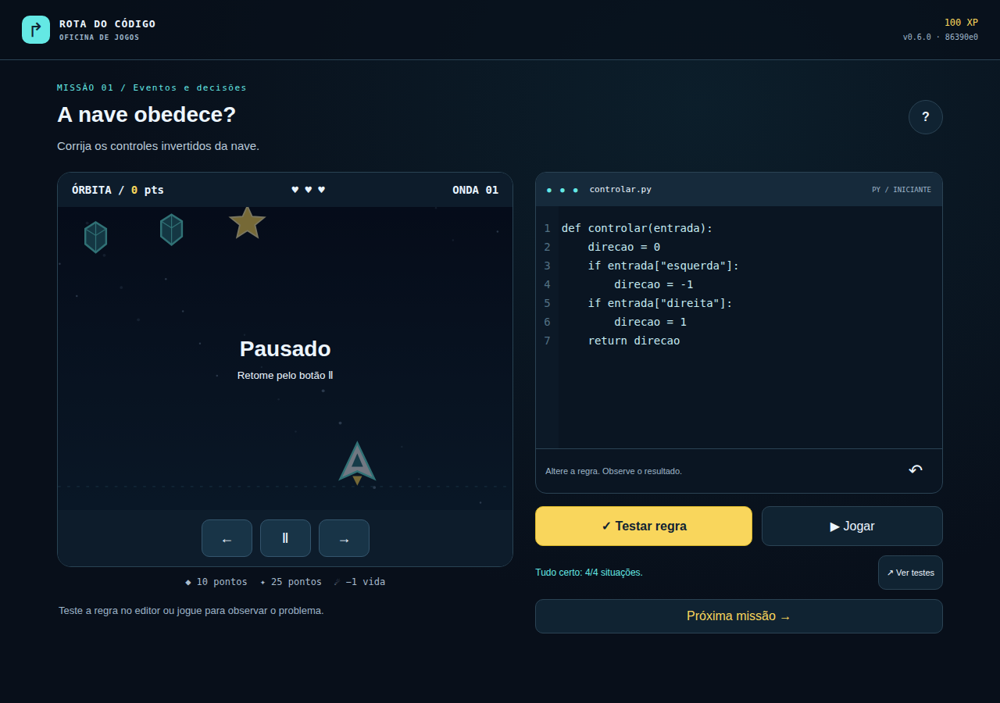

# CI e Pages executados — Python 0.6.0, 12/10/2026

R02/R03/R04/D04/D05 local/S01/S02, INT-02/03/04/05/06/07 parcial. [Preview público](https://luccalck.github.io/desafio-arcade/) e [HML](https://luccalck.github.io/desafio-arcade/hml/), executados sem merge na main. Fonte86390e0fa422974084b70095389faa857dd40737, [push38323824787](https://github.com/luccalck/desafio-arcade/actions/runs/38323824787) e [PR38323827764](https://github.com/luccalck/desafio-arcade/actions/runs/38323827764) success. Qualidade/segurança/build/E2E/ci passaram; publicar-preview passou no push, foi corretamente ignorado no PR.

Resultados conferidos dos artefatos reais:

- 178 testes:152unidades/26integrações; zero falhas/erros/skips.
- 15 E2E: zero falhas/erros/skips,20,38s; campanha/final/download.py/HTMLoffline/mobile/indentação/legado/regra antiga.
- 2 smokes do site público: zero falhas/erros/skips,5,77s. Verificaram HTTP/versão/Python/edição/movimento em HML e release e root→SHA certo.
- Core: instruções97,90%,branches95,23%,funções/linhas100%.
- Gitleaks0/auditprodução0/SBOM; reprodutibilidade passou com apenas data normalizada.
- GDDCI0.6.0/12pA4/331.037bytes/pdfinfo/texto/data12/10; GDDlocal12p/361.562bytes, todas as páginas inspecionadas.
- BuildZIP:26.487bytes, sete arquivos, checksum confrontado com bytes reais. SHA25627f4adf7a5caaaa532bf086a3a49f4549e551a9a9ceec64284ccba04b1ad641e.

version.jsonCI0.6.0/SHA86390e0fa422974084b70095389faa857dd40737/build2026-10-12T23:46:02.728Z. Os sete arquivos publicados em /releases/86390e0fa422974084b70095389faa857dd40737/ foram recuperados por HTTP e seus SHA-256 comparados byte a byte com as entradas desse ZIP: iguais. HML/version.json e rollout.json também conferidos por HTTP. gh-pages foi criado pelo job, commitfa826609c3e7c05b8399a68ae6e93610686e29a4, identidade explícita github-actions[bot]. Fonte/commits de desenvolvimento usam luccalck, não colaboradores fictícios.

Workflow criado23:45:49UTC, publicar-preview concluído23:47:21UTC:92s entre esses eventos; isso não é medição DORA de produção ou horário exato do push. Artefatos baixados tmp/ci-38323824787, conferência tmp/ci-python-pages-verificada.json. JUnit/capturas/trace públicos nos artefatos preview-SHA ligados ao run. Captura abaixo vem do navegador real que acessou o Pages na pipeline; não é mockup, progresso injetado ou playtest humano.

Limites: preview autorizado, main protegida/PRdraft/review_required. Sem aprovação formal em producao, canário/azul-verde validado, rollback/recovery<5min, sondas/DORA/tagfinal/triagem/vídeo/relatório/banca. G0 e revisão/contribuição dos quatro permanecem pendentes; nenhum INT integralmente fechado. Execuções posteriores têm SHA/date próprios e são registradas no acompanhamento, preservando esta evidência histórica verificável.
