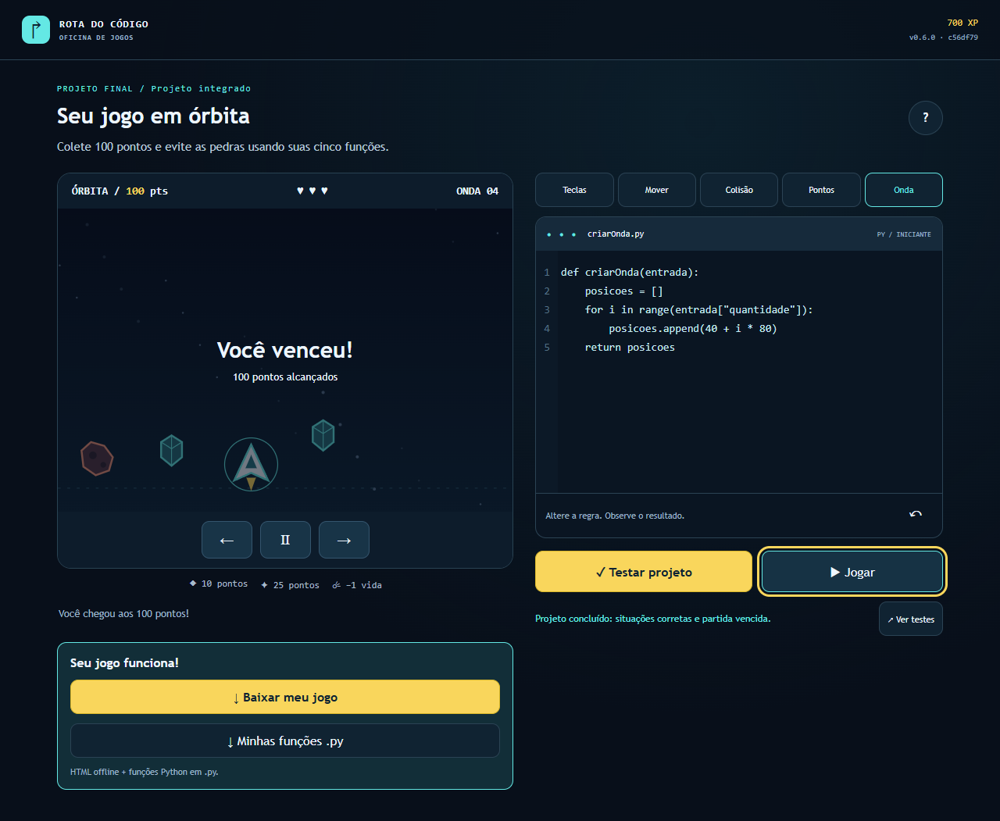
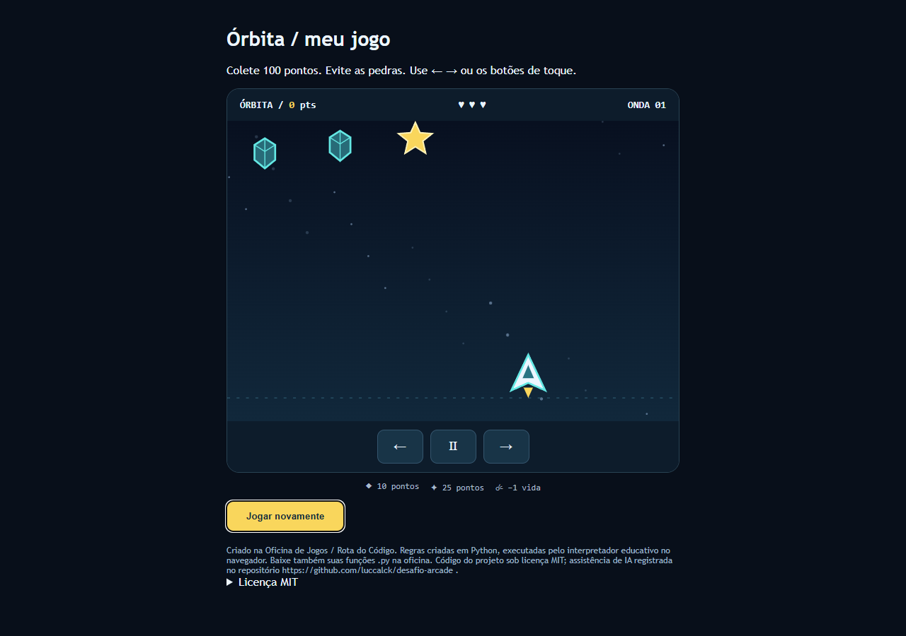

# Passo 010 — Build offline e integridade antes da HML

Executamos somente010, INT-06/04, D04/R02, em13/10/2026. Fonte testada em clone limpo: **c56df79d58eda2a8ab6a518b7011ff6eaa21e8da**, versão0.6.0. Não houve alteração de mecânica, dependência, build/package ou publicação de produção. Originais do professor preservados, com hashes inalterados.

## Execução e correção observadas

Reutilizamos scripts/build.mjs, scripts/package.mjs, scripts/reproducibility.mjs e as integrações de exportação existentes. Acrescentamos tests/e2e/offline-package.spec.mjs: empacota a build em pasta isolada, confere checksum/tamanho/arquivos/versão, descompacta e percorre toda a campanha pelo editor e controles reais com rede desabilitada antes de abrir file://. Não injetamos progresso, vitória ou funções pelo estado interno.

Primeiro cenário focal passou em14.9s. Em seguida npm run lint falhou com158erros no game.js gerado sob.contexto e2avisos de relatórios antigos: a pasta administrativa era ignorada no Git, mas não no ESLint. Acrescentamos somente.contexto/** aos ignores do ESLint; src, scripts e tests seguem analisados. O mesmo npm run lint passou. É correção de configuração de QA, não bug de jogabilidade criado para a rubrica. Não removemos artefatos ou mudanças pessoais para ocultar a falha.

Criamos clone temporário de validação em.contexto/passo-010/clone-validacao usando git clone --no-local, branch010, core.autocrlf=false. Não é uma segunda fonte de desenvolvimento; o projeto principal permanece jogo-arcade. Status Git vazio antes/depois, fontes restauradas byte a byte após ensaio.

## Comandos e resultados reais

[Registro datado dos oito comandos](offline-010/comandos.json). Todos com exit0 no clone:

| Comando | Resultado |
|---|---|
| npm ci | Lockfile instalado sem etapas manuais |
| npm run lint | ESLint/TypeScript verdes |
| npm run test:ci |184testes de unidade/integração; core97,90%instruções/95,23%branches/100%funções/linhas |
| npm run build | Seis missões válidas; dist0.6.0/SHA/data |
| npm run gdd:pdf |12seções/highconcept804caracteres; PDF18pA4, pdfinfo válido |
| npm run package | ZIP28.581bytes, inferior a25MiB e a25MBdecimais; checksum confere |
| npm run reproducibility | Duas builds do mesmo commit; todos os hashes iguais normalizando exclusivamente build de version.json |
| npm run test:e2e -- --workers=1 |18cenários passaram, incluindo campanha completa do ZIP offline |

[JUnit unidade/integração](offline-010/unidade-integracao.junit.xml), [JUnit E2E](offline-010/e2e.junit.xml), [pdfinfo](offline-010/pdfinfo.txt), [comparação dos hashes](offline-010/reproducibility.json). Logs em cópias textuais UTF-8/LF sem espaços finais estão na mesma pasta; dados de execução preservados, brutos em.contexto/passo-010. [Hashes brutos e versionados](offline-010/logs-manifesto.json). GDD não mudou neste passo; mantemos revisão009, coerente com software0.6.0, sem inventar data de release final.

## ZIP e proveniência

[Integridade e manifesto dos sete arquivos](offline-010/integridade.json). Pacote do comando package:

- 28.581bytes; SHA-256 **c2aeee6ddbc6a9ffb18a0ebebbee9d1671732e6e9279a91cf492fc689ad348f4**.
- SemVer0.6.0; SHAcompleto c56df79d58eda2a8ab6a518b7011ff6eaa21e8da; build2026-10-13T18:05:02.107Z.
- index.html, game.js, style.css, version.json, LEIA-ME.txt, LICENSE.txt e THIRD_PARTY.txt.

O cenário offline empacotou a build final do comando reproducibility em sua pasta isolada: checksum/datas próprios estão em campanha.json. São duas construções locais de validação no mesmo commit, comparadas conforme o enunciado; não são promoção HML→PRD. A promoção deverá recuperar o mesmo ZIP aprovado da CI e conservar seu checksum, sem reconstrução nos ambientes.

LEIA-ME instrui descompactar e abrir index.html; o jogador não instala engine, Node ou Python. Tela inicial mostra0.6.0 e SHAcurto coerentes. LICENSE incluiMIT; THIRD_PARTY mantém créditos do produto. Mapas/referênciasStitch/PDF não são dependências da partida nem recursos remotos da build.

## Offline real e exportações

[Metadados da campanha](offline-010/campanha.json): cinco missões pelo editor,23casos no final, partida pilotada até100pontos/700XP; **zero requests HTTP/HTTPS e zero pageErrors**, contextooffline antes de abrir o index descompactado. Teste adicional abre o HTML realmente baixado viafile://, inicia e move a nave sem rede. Arquivo.py realmente baixado contém as cinco fontes usadas e licençaMIT; não executamos Python como requisito para o jogador. Editar.py não recompila o HTML.

Essas capturas vêm de Chrome/Playwright no clone testado. Não representam HML/PRD, pesquisa com usuários ou medidas de aprendizagem. A exportação do aprendiz é distinta do pacote acadêmico submissao.

## Ensaios dos bloqueios

[JSON inválido](offline-010/json-invalido.json): alteramos temporariamente missions.json no clone para sintaxe deliberadamente inválida; npm run build terminou com exit1. [Log da falha](offline-010/build-json-invalido.log). Restauramos os bytes originais, content:check passou e Git permaneceu limpo. Nenhum conteúdo inválido foi commitado.

[Scanner sintético](offline-010/scanner-sintetico.json): Gitleaks8.30.1 com configuração do projeto/--redact retornou exit1,1finding regra github-pat. Usamos apenas string pseudoaleatória comseed10 não emitida por serviço, sem conta/credencial real. A primeira sequência previsível retornou0/0achados e não foi usada como prova positiva. Fixture e relatório bruto ficam ignorados em.contexto, nunca no pacote. O ensaio é local; não equivale a incidente ou CI deliberadamente vermelha.

Main foi reconferida pela API: ci obrigatório,1aprovação e proteção de administradores. Os jobs reais de conteúdo/segurança alimentam o gate agregado; não enfraquecemos proteção ou scanner.

## Aceites e encaminhamento

I06-01–06/13/14/16 e I04-01–07/15 foram revalidados no escopo atual, sem fechar release/produção finais. **G2 tem base técnica validada, mas permanece aberto como checkpoint sequencial**: G0/G1 ainda têm dados/acessos/entendimento/revisões humanos pendentes e não houve integração revisada na main. A IA não aceita o squad ou os direitos pelos quatro.

Passagem Lucca→Davi em [registro do bloco](../execucao/06-passagem-lucca-davi.md). Revisão de outro autor, direitos coletivos, RAs adiados e aceites de acesso continuam no registro único. O bloqueio de solicitar Davi como revisor foiAPI422 no008; não simulamos review nem repetimos a mesma tentativa. Davi pode preparar011 sobre a candidata010 verde; publicarHMLformal exige main revisada e contrato/flags corretos. Não executamos011 neste passo.

CI/PR/commits publicados serão registrados abaixo e no controle; os artefatos de CI são a origem para a futura HML, não os ZIPs locais desta conferência.
