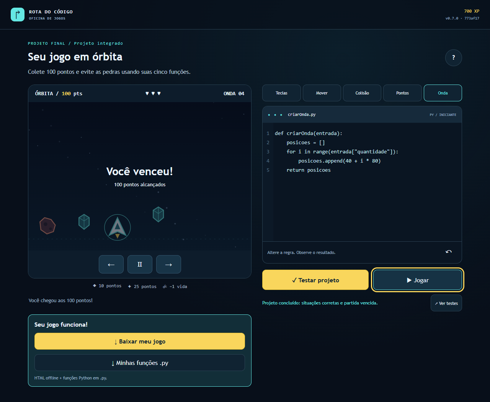

# Verificação operacional — 15/10/2026

Executamos a reconferência da Rota do Código com dados do GitHub, navegação real no Chromium e o ZIP original da CI. Esta evidência atende parcialmente C02, D06/D07, R03–R06 e S03–S06 / INT-03, 04, 06, 07, 08 e 10. Não encerra G3–G8 nem declara nota, aprendizagem humana ou produção formal inexistente.

## Versões e revisão

O PR #32 recebeu aprovação de `6lucassilvaaa` no commit `59dc830` e foi integrado à `main` por merge normal, preservando as autorias. A publicação resultante usa `773af17db29bb9fc46bfe438c0cb9c8304fbd5f5`, versão 0.7.0. A proteção exige CI e revisão externa e continua ativa.

A correção da medição HML está no [PR #33](https://github.com/luccalck/desafio-arcade/pull/33), commit `78c367d1ace0dc8b103cf6b02009dbf0d1616321`. Conferimos o diff, as fontes de tempo, a correspondência SHA/ref/repositório, os casos negativos e as duas execuções verdes. Na consulta desta etapa, não havia revisão registrada: `REVIEW_REQUIRED`, `reviews=[]`. A conta autenticada é `luccalck`, autora do PR; não pode produzir a aprovação externa exigida. A revisão técnica assistida por IA não substitui essa ação.

| Origem | Resultado observado | Limite |
|---|---|---|
| [Main 38674290799](https://github.com/luccalck/desafio-arcade/actions/runs/38674290799) | CI verde; HML publicada; quatro regressões públicas passaram | Job HML falhou depois, na fonte de tempo; PRD foi ignorada |
| [Push PR33 38674970174](https://github.com/luccalck/desafio-arcade/actions/runs/38674970174) | 273 testes de unidade/integração e 36 E2E; lint, segurança, build e pacote aprovados | Deploys ignorados por ser branch de desenvolvimento |
| [PR33 38674975441](https://github.com/luccalck/desafio-arcade/actions/runs/38674975441) | Checks obrigatórios aprovados no mesmo HEAD | Sem aprovação externa nem merge |

## HML e o mesmo artefato

Baixamos o artefato `pacote-ci-773af17db29bb9fc46bfe438c0cb9c8304fbd5f5-38674290799-1`, sem recompilar. O verificador de contrato confirmou os **173 arquivos** do bundle por inventário, tamanho e SHA-256. Também validamos o bundle do PR33, com 173 arquivos, sem confundi-lo com a versão publicada.

O ZIP da HML tem **29.025 bytes**, abaixo de 25 MB, e SHA-256 `cedfa3b16b12e09fd77beaf9d8f9963b7341a9504bde5467ae8e19d617ba6a70`. Em 15/10 às 16:37:29 UTC, buscamos os sete arquivos de `/hml/` e comparamos seus corpos com os bytes descompactados. Todos responderam HTTP 200 e tiveram hashes idênticos: `index.html`, `game.js`, `style.css`, `version.json`, `LEIA-ME.txt`, `LICENSE.txt` e `THIRD_PARTY.txt`.

[Comparação HTTP/ZIP](operacao-2026-10-15/hml-zip-http.json). Esta prova é de HML, não da produção formal.

Reconstituímos o intervalo histórico usando `merged_at` do PR32, com `merge_commit_sha` e destino `main` conferidos, e `completed_at` da etapa de regressão HML na API de jobs: **03:03:48 → 03:06:59 UTC, 191 segundos (3min11s)**. Não usamos a data do commit nem a criação do run como horário do push. Essa reconstrução não transforma o job vermelho em verde nem substitui nova execução automática do coletor corrigido. [Fonte e cálculo](operacao-2026-10-15/hml-tempo-historico.json).

## Jogo no navegador e offline

Executamos novamente quatro cenários contra a HML pública, em contextos novos de navegador, sem alterar storage para desbloquear fases: **4/4 aprovados em 62,01 segundos**. Em 1280×900 por teclado e 390×844 por toque, percorremos as cinco missões, testamos uma resposta incorreta, usamos a ajuda, executamos os 23 casos do projeto integrado e pilotamos até a vitória real de 100 pontos e 700 XP. Também verificamos reinício confirmado, persistência e bloqueio das fases futuras; a campanha não registrou erros de página.

Captura real de 15/10/2026; versão/SHA e instante constam no [JSON original](operacao-2026-10-15/hml-desktop-encerramento-real.json). [JUnit](operacao-2026-10-15/hml-junit.xml), [vídeo desktop](operacao-2026-10-15/hml-desktop-campanha.webm) e [vídeo por toque](operacao-2026-10-15/hml-toque-campanha.webm). São gravações de teste automatizado, **não pitch** nem sessão humana de aprendizagem.

Descompactamos o ZIP original da mesma execução, colocamos o navegador offline **antes** de abrir `file://` e repetimos a campanha completa. **1/1 cenário aprovado em 14,9 segundos**: cinco missões, 23 casos finais, vitória, downloads reais `.py` e HTML, abertura do HTML exportado e movimento real da nave. Registramos **zero requisições HTTP/HTTPS e zero erros de página**. Não reempacotamos uma build local para representar a CI. [Resultado](operacao-2026-10-15/zip-offline.json) e [JUnit](operacao-2026-10-15/zip-ci-junit.xml).

A execução técnica verifica funcionalidade e coerência. O playtest exigido com colega iniciante de outra turma, por três minutos sem explicação, continua pendente em [playtest.md](playtest.md); não inferimos compreensão, interesse ou aprendizagem a partir do sucesso dos testes.

## Smoke da raiz existente

Também executamos o smoke real da raiz pública, com o SHA e SemVer efetivamente servidos: **preview 0.6.0 / 71933bf**. Passou **1/1 em 9,7 segundos**, verificando ponteiro, recursos, versão, redirecionamento, editor, regra aplicada, movimento real e pausa, com zero erros coletados. [JSON](operacao-2026-10-15/preview-smoke.json) e [JUnit](operacao-2026-10-15/preview-smoke-junit.xml). O nome técnico do projeto de teste é `prd-smoke`; a versão testada continua sendo preview. Esse sucesso não comprova publicação formal da candidata 0.7.0.

## Observabilidade executada

Conferimos duas execuções agendadas e disparamos uma nova coleta manual pelo workflow existente, sem publicar Pages:

| Run / origem | Horário da amostra HML (UTC) | HML HTTP / segundos | Raiz HTTP / segundos |
|---|---|---|---|
| [38704560758 / schedule](https://github.com/luccalck/desafio-arcade/actions/runs/38704560758) | 08:17:16 | 200 / 0,167014 | 200 / 0,103497 |
| [38744110194 / schedule](https://github.com/luccalck/desafio-arcade/actions/runs/38744110194) | 13:36:26 | 200 / 0,171753 | 200 / 0,094492 |
| [38770216623 / manual](https://github.com/luccalck/desafio-arcade/actions/runs/38770216623) | 16:35:19 | 200 / 0,338412 | 200 / 0,195551 |

As três execuções terminaram com sucesso, incluindo a reconciliação de alertas. Os seis registros estão no [CSV preservado](operacao-2026-10-15/sondas.csv) e na branch de dados `observabilidade`. HML identifica 0.7.0/`773af17`; a raiz identifica **preview 0.6.0/`71933bf`**. Os campos `formalHml`/`formalPrd` dos JSON representam flags habilitadas, não atestam deploy aprovado.

Os relatórios `alertas-*.json` têm `actions: []`: não houve falha HTTP ou latência acima de 2 s nessas amostras. Isso prova coleta/reconciliação saudável, mas **não prova abertura, deduplicação ou fechamento de uma Issue de incidente real**. A consulta de Issues só encontrou a Issue histórica #1, sem alertas operacionais.

O cron está definido como `*/15 * * * *`, mas as duas execuções agendadas observadas ficaram separadas por aproximadamente 5h19. Portanto, não afirmamos coleta efetiva a cada quinze minutos nem disponibilidade contínua a partir dessas seis amostras. O painel público `/status/` retornou 404 nesta etapa; sua publicação e reconferência permanecem pendentes.

O cálculo DORA executou com fontes reais do GitHub, mas retornou as quatro métricas sem valor: nenhum `deploy-prd` formal bem-sucedido para frequência/lead time/taxa de falha e nenhuma Issue de alerta aberta e fechada para MTTR. A linha de base de onze dias está registrada; comparação e efeito de melhoria exigem observações reais posteriores. [DORA da última coleta](operacao-2026-10-15/dora-38770216623.json).

## Recuperação: teste local e lacunas operacionais

Passaram **53/53 testes locais** em oito arquivos, cobrindo produção, rollout, CLI, propagação, monitor, alertas, observação e DORA. Conferimos também sete arquivos em cada uma das duas baselines de preview: **14 respostas HTTP 200**, com hashes idênticos ao commit fixado de `gh-pages`. [Execução local](operacao-2026-10-15/recuperacao-local.json) e [baselines](operacao-2026-10-15/recuperacao-baselines.json).

Não disparamos recuperação sobre um preview como se fosse um incidente formal. Ainda faltam produção formal saudável, nova candidata controlada, injeção explícita de falha de validação, relógio desde a falha até hashes/smoke públicos e sondas contínuas durante a janela. O workflow manual atual só oferece motivos de incidente; não registramos um incidente inexistente. Os limites individuais de publicação, propagação e smoke também não garantem, somados, menos de cinco minutos.

O [roteiro do ensaio](ensaio-recuperacao.md) permanece aplicável: estabelecer baseline aprovada, identificar claramente ensaio e defeito, preservar o job vermelho, verificar recuperação automática/manual pela pipeline e medir o tempo completo incluindo Pages. Não adulterar artefatos imutáveis, remover proteção, cancelar publicação arbitrariamente ou inventar Issue de queda para obter uma marcação.

## Comandos e continuidade

Executamos `gh pr view 33`, `gh run view/download` das execuções acima, `gh workflow run monitor.yml --ref main`, `node scripts/ci-bundle.mjs verify` para os dois bundles e Playwright contra a HML pública. Os harnesses de evidência ficaram em `.contexto/execucao-2026-10-15/`; os cenários funcionais reutilizam [regressão pública](../../tests/e2e/regression.mjs), [pilotagem](../../tests/e2e/helpers.mjs) e [teste offline](../../tests/e2e/offline-package.spec.mjs), adaptando a entrada para consumir o ZIP da CI, sem nova build. O [manifesto das evidências](operacao-2026-10-15/manifesto-evidencias.json) permite conferir os arquivos preservados; não é o manifesto da submissão.

Próximas dependências: revisão externa e merge protegido do PR33; nova execução automática de HML; aprovação real em `producao`; prova de sete arquivos, smoke, painel e sondas pós-produção; ensaio rastreável de recuperação e alertas; DORA e melhoria medida. A release técnica pode ser preparada após a produção aceita. **O pacote acadêmico final e a triagem na tag final continuam bloqueados pelo pitch real**, além dos demais aceites. Mantemos `SUBMISSAO_ENABLED` e `TRIAGEM_AGENDADA_ENABLED` desabilitados até existirem as entradas verdadeiras.

A ficha é a seção 10 do HTML do professor, que gera o TXT de entrega. Por orientação de Lucca, atualizamos somente [as respostas persistentes](../gestao/ficha-entrega.md), sem preencher o HTML, aceitar declarações ou gerar TXT nesta etapa. Todas as pendências ficam no [registro único por passo](../execucao/05-pendencias-por-passo.md).

Revisão complementar de15/10: o PR33 recebeu o commit770449b, que declara pull-requests:read somente no deploy-hml para a consulta de PR associado ao merge. A validação da lógica em78c367d continua histórica; o novo HEAD exige checks e revisão próprios. Runs de reconferência:38772409905(push) e38772414475(PR). A aprovação externa ainda não estava registrada ao preparar este documento. Não alteramos o limite de900s nem a proteção da main.
