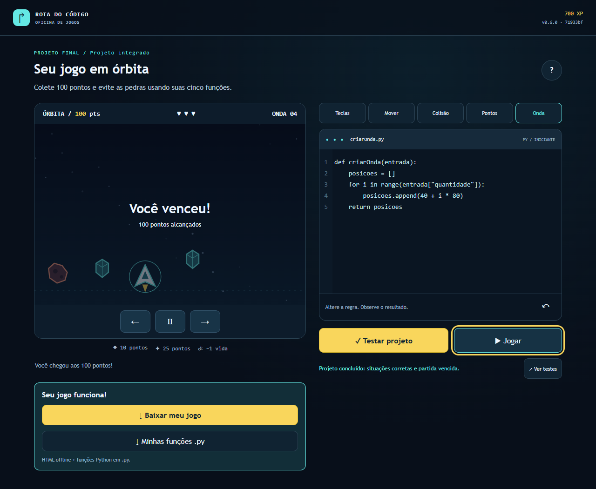
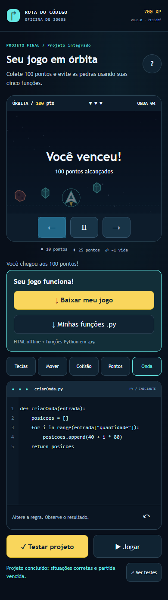

# Passo 006 — Regressão de navegador

Revisão de 13/10/2026. Escopo: D05/R04, INT-04/03; preparação G2 e execução experimental no preview, sem aceite G3 formal. Fonte do jogo local: `36095a05f510f007dc0a413599b8dcd6e564ea99`, v0.6.0. Os testes foram editados nesta branch antes da gravação do commit; não atribuímos essas alterações ao SHA anterior.

## O que implementamos

Compartilhamos o roteiro em `tests/e2e/regression.mjs`, usado na suíte local e em `tests/deploy/pages.spec.mjs`. Dois cenários completos verificam:

1. HTTP, SemVer e SHA no JSON e na tela; menu, início, ajuda, tentativa incorreta que não libera avanço, correção da primeira função e 100 XP, cinco missões, projeto com 23 situações, pilotagem real até 100 pontos, vitória/700 XP e downloads disponíveis.
2. Primeira conclusão, liberação da próxima missão e bloqueio das posteriores, fonte preservada ao voltar, reinício confirmado pelas opções e estado inicial após recarregar.

O teste preenche o editor com fixtures versionadas e aciona controles reais. Não escreve progresso/solução no storage nem chama funções internas para vencer. Lê DOM/HTTP; a pilotagem lê posições visíveis e usa teclado ou eventos touchStart/touchEnd enviados pelo Chrome DevTools Protocol. Emulação de toque não é certificação de aparelho físico. O helper anterior usava mouse para esse percurso; agora os eventos de direção são de toque.

`playwright.public.config.mjs` separa projetos `hml-desktop`, `hml-toque` e `prd-smoke`. HML roda os dois cenários em1280×900 e390×844; PRD roda smoke curto com loader, ponteiro ativo, release do SHA esperado, editor e movimento. A estratégia observada é preview; ainda não comprovamos rollout final ou recuperação.

SHA esperado obrigatório (40 caracteres), URLs HTTP(S) sem credenciais, nenhuma repetição automática da suíte pública (`retries:0`). Espera por publicação: até60s, intervalos1/2/5s e consultaHTTP de até10s, com erro/status observados no resultado da falha. O teste termina em erro se o SHA não aparecer. Timeout de cenário120s. JUnit, relatório HTML, screenshots, traces de falha e JSON com data/URL/versão/SHA/cenário/viewport acompanham a execução.

## Validações executadas

| Comando / execução | Resultado real |
|---|---|
| `npm run build` | exit0, conteúdo de6missões validado; jogo não alterado |
| `npm run lint` | exit0, ESLint e TypeScript |
| `npm run test:e2e` (4workers locais) | exit1:14passaram/3falharam por encerramento/crash do Chrome; relatórios preservados |
| `npm run test:e2e -- --workers=1` | exit0:17passaram,50,8s; mesmos cenários, nenhuma falha silenciada |
| Dois cenários novos após ajustes de metadados/espera | exit0:2passaram,15,6s |
| Configuração pública sem EXPECTED_SHA | exit1 antes de executar: dado obrigatório ausente |
| Primeira execução pública (consulta de5s) | exit1:3passaram/2falharam na esperaHTTP; não foi registrada como sucesso |
| Configuração pública final, cinco cenários | exit0:5passaram,56,2s; sem retry de teste |

A primeira suíte pública falhou antes de interagir em dois cenários: consultas de versão não terminaram no limite de5s. Uma consulta isolada retornouHTTP200; ampliamos o limite da consulta para10s e mantivemos60s totais. A execução seguinte passou integralmente. Isso é ajuste do teste à espera de publicação, não bug educativo artificial nem medição DORA/latência da produção.

URL real testada: https://luccalck.github.io/desafio-arcade/hml/ . Release/loader: https://luccalck.github.io/desafio-arcade/ . SHA publicado real: `71933bfd4bd35f8c3ac8f5899a0e9af00db29f32`, v0.6.0, build2026-10-13T02:06:51.969Z. Não publicamos uma nova versão para executar006.

[Resumo derivado dos JUnit e hashes](imagens/passo-006/validacoes.json). Originais de sucesso/falha ficam em `.contexto/passo-006/`, ignorado; CI arquiva `reports/` e `test-results/`. As capturas abaixo vieram diretamente das execuções bem-sucedidas do preview, foram inspecionadas e não são mockups ou telas de produção formal:



[Metadados desktop](imagens/passo-006/preview-hml-desktop-encerramento.json).



[Metadados toque](imagens/passo-006/preview-hml-toque-encerramento.json).

## Contrato entregue à Plataforma

Na raiz do clone, depois de recuperar o mesmo artefato do CI, configurar o ambiente do job com valores reais:

```sh
BASE_URL=https://luccalck.github.io/desafio-arcade/hml/ EXPECTED_SHA="$GITHUB_SHA" npx playwright test --config playwright.public.config.mjs --project=hml-desktop --project=hml-toque
```

`BASE_URL` é a URL direta da HML, com barra final normalizada. Alternativa: `PAGES_URL` da raiz deriva /hml/. Smoke independente:

```sh
PAGES_URL=https://luccalck.github.io/desafio-arcade/ EXPECTED_SHA="$GITHUB_SHA" npx playwright test --config playwright.public.config.mjs --project=prd-smoke
```

No PowerShell, use variáveis `$env:BASE_URL`, `$env:PAGES_URL` e `$env:EXPECTED_SHA`; não copie a sintaxe de atribuição POSIX. Para testar o preview atual, use seu SHA real indicado acima; para HML formal, o job fornece SHA do artefato aprovado. EXPECTED_VERSION pode informar SemVer esperado quando necessário; padrão é package.json do checkout correspondente.

O011 deve rodar a regressão a cada deploy-hml e arquivar `reports/pages-smoke.xml`, `reports/pages-e2e/` e `test-results/`; falha bloqueia promoção. O014 integra smoke na produção e o019 garante mesmo artefato/aprovação. Não modificamos workflows neste006. O preview antigo já chama a configuração pública inteira quando sua branch autorizada é publicada; isso não substitui os jobs formais.

## Checks e pendências

I04-07 revalidado com17cenários locais. I04-08/I04-09/I03-16 permanecem abertos conforme divisão006→011: roteiro preparado e executado no preview, falta execução formal de HML da main aprovada após cada deploy. I04-10 depende do smoke pós-produção formal014/019. Nenhum novo check geral fechado; G3 não aceito, revisão de outro autor continua necessária antes do merge. Pendências no [registro único](../execucao/05-pendencias-por-passo.md).

## Publicação e CI

Commit próprio `1e0b4b56464af2b3d762a8292f513449197ebc87`, identidade Git/GitHub luccalck conferida; hook Gitleaks sem achados e push concluído. [PR#8](https://github.com/luccalck/desafio-arcade/pull/8) em rascunho, base temporária005 para isolar este passo. [CI38348580349](https://github.com/luccalck/desafio-arcade/actions/runs/38348580349) SUCCESS: qualidade, segurança, build, E2E e aceite agregado passaram; preview ignorado por branch.

Baixamos o artefato e2e do SHA acima e conferimos seu JUnit:17testes,0falhas,0erros,0ignorados. O jogo local/CI e o preview público têm SHAs diferentes explicitamente registrados; não afirmamos que a candidata006 foi implantada. Relatórios originais em `.contexto/passo-006/ci-38348580349/`.

Por autorização persistente, a branch padrão foi atualizada para `feature/passo-006-regressao-hml` após a CI verde. API confirmou main protegida por ci/uma aprovação/incluindo administradores. Isso atualiza rastreamento; não faz merge, revisão humana ou deploy. Registros documentais posteriores acionam CI própria a conferir pelo HEAD.


## Execução contra HML da main — 15/10/2026

O deploy-hml da run38674290799 publicou773af17/0.7.0 e executou4/4cenários públicos antes de falhar no coletor de tempo. Repetimos a regressão pública:4/4passaram em62,01s, incluindo campanha até vitória700XP e reinício emdesktop1280×900 e toque390×844. Sete arquivosHTTP foram comparados ao ZIP original da CI e todos tiveram hashes iguais. I04-08/I04-09/I03-16 foram fechados somente por essas evidências específicas; o aceite integralG3 continua dependente da nova run com a correçãoPR33 revisada. [Resultados/JUnit/vídeos](operacao-2026-10-15.md).
