# Rota do Código — Game Design Document

Versão do software: **{{VERSION}}** (gerada de `package.json`). Revisão do documento: **032 — 19/10/2026 (America/Sao_Paulo)**. Mantemos a oficina de jogos aprovada, com desafios Python e produção web validada. Esta revisão documental registra a produção1.0.0/be28149 e o vídeo validado; sua data não representa reciboAVA. Preservamos a revisão anterior no PDF imutável gerado para a tag e registramos separadamente este fechamento pós-execução.

| Identificação | Situação verdadeira |
|---|---|
| Jogo / atividade | Rota do Código / Desafio Arcade — Integração e Entrega Contínua, DevOps |
| Squad | Aura 67 |
| Coordenação de Produto | Lucca Castilho Costa; participação dos quatro em todas as áreas |
| Data de submissão | Ainda não houve submissão final registrada; preencher na entrega real |
| Repositório | https://github.com/luccalck/desafio-arcade |
| PR do primeiro ciclo | https://github.com/luccalck/desafio-arcade/pull/2; histórico do primeiro ciclo, sucedido pelas integrações revisadas #32, #33, #34, #40 e #41 |
| Produção pública do jogo | https://luccalck.github.io/desafio-arcade/ |
| Homologação formal | https://luccalck.github.io/desafio-arcade/hml/ |
| CI de referência conferida | https://github.com/luccalck/desafio-arcade/actions/runs/39346940628 — main1.0.0;325testes/37E2E;HML/PRD/monitorSUCCESS |
| Produção / homologação / vídeo / release | Produção/HML1.0.0/be28149, run39346940628 verde; tagv1.0.0 anotada; pitch86s validado na entrada-video39348162168; resultado da publicação/pacote/triagem na evidência de entrega. Revisão final dispensada pelo proprietário, semAPPROVEfictício |
| Release técnica pública | https://github.com/luccalck/desafio-arcade/releases/tag/v0.7.0 — SHAe9, bundle38852413982/2, publicado pela retomada38940532129 após aprovaçãoPR40 |
| Plataforma | WEB estática responsiva, mesma experiência no computador e celular |

### Equipe

| Integrante | RA | Coordenação | GitHub |
|---|---|---|---|
| Lucca Castilho Costa | 26179873 | Produto e Game Design | luccalck |
| Davi Marcondes Paes de Souza | 26180842 | Desenvolvimento e Qualidade | DaviSouza78 |
| Miguel Oliveira de Almeida | 26179933 | Plataforma e Release | miguelsenai2024 |
| Lucas Souza da Silva | 26179875 | SRE e Segurança | 6lucassilvaaa |

Papéis coordenam, sem exclusividade. Os nomes completos e RAs de três integrantes foram informados em13/10/2026. Lucca informou seu nome completo e RA 26179873 em 14/10/2026; a tabela contém os quatro RAs reais. Fonte dos dados: [SQUAD](../SQUAD.md).

Registro histórico, superado pela implantação formal abaixo. Consulta pública em 14/10/2026: raiz e `/hml/` responderam HTTP 200, mas a HML servia a versão 0.6.0 do SHA `71933bfd4bd35f8c3ac8f5899a0e9af00db29f32`, anterior a este MD. `/status/` respondeu HTTP 404. Essas URLs não comprovam a candidata atual, produção formal ou painel publicado. O PR técnico mais recente antes desta revisão é [#21](https://github.com/luccalck/desafio-arcade/pull/21), com CI verde e revisão humana ainda pendente.

Em 15/10/2026, após aprovação real de Lucas no PR33, integramos o SHA `88d533e31452036092cd8edef3efa3c0775241dc`. A execução 38829484114 validou 299 testes, 36 E2E, quatro cenários HML e promoção azul-verde com aprovação registrada em `producao`. HML ficou pronta em 216,414 segundos. ZIP original de 29.000 bytes validado offline; catorze comparações HTTP de sete arquivos em HML e produção confirmaram os mesmos bytes. `/status/` respondeu 200. [Evidências operacionais e limites](evidencias/operacao-2026-10-15.md). Essa revisão histórica foi aprovada porLucas noPR34. A dispensa expressa da revisão do fechamento1.0.0 não foi registrada comoAPPROVE.

A aprovação de concepção não substitui revisão por outro integrante. CPF e assinaturas não integram Git ou artefatos públicos; eventual versão privada depende de orientação do professor. Declaração coletiva e links de release continuam pendentes. Capturas históricas locais não representam produção. Capturas atuais de HML/produção estão identificadas nas evidências; testes automatizados não substituem playtest humano.

## 1. Premissa e problema endereçado

Iniciantes podem memorizar comandos sem entender como uma regra altera um programa. A oficina relaciona eventos, variáveis, condições, estado e repetição a um resultado observável: construir funções de um minijogo. Público: pessoas com leitura básica em português, familiaridade com teclado/toque e sem conhecimento prévio de Python. Editar código no celular pode ser mais trabalhoso e precisa de avaliação humana.

Cada missão começa com um defeito numa função curta. O jogador altera código, compara saídas para entradas diferentes e experimenta o efeito numa nave controlável. Ajuda direta fica sob demanda. Cinco missões compõem um projeto integrado exportável como HTML jogável offline e funções Python .py para estudo. XP e desbloqueios sinalizam progresso; não medem aprendizagem. Clareza, diversão e transferência de conhecimento ainda exigem playtest humano; nenhum ganho educativo foi medido.

## 2. High concept

Rota do Código é uma oficina educativa web em que o jogador constrói um minijogo de nave corrigindo cinco funções Python. Controles, movimento, colisão, pontuação e criação de ondas transformam eventos, operações, condições, estado e repetição em efeitos visíveis. Cada regra precisa funcionar para entradas diferentes, com ajuda e testes públicos sob demanda. No desafio final, as cinco funções do jogador comandam uma partida real: alcançar 100 pontos com três vidas libera a exportação de um HTML independente, jogável offline, e das funções .py para continuar estudando. Menus, seis missões e até 700 XP organizam a campanha. O diferencial é produzir e depurar regras de um jogo concreto, relacionando código e comportamento, em vez de repetir uma sequência de comandos ou responder apenas perguntas.

## 3. Gênero e plataforma

Jogo educativo de programação e depuração, com minijogo arcade de coleta e desvio. Destino obrigatório **WEB**, estático e responsivo; sem aplicativo nativo, APK ou instalação de engine para o jogador.

TypeScript, HTML/CSS/SVG e esbuild IIFE, sem framework de interface ou engine física. Core puro separado da renderização; Ajv valida conteúdo, Vitest testa regras/integração e Playwright testa navegador. Node 24 e lockfile são ferramentas de desenvolvimento/CI. Conteúdo, player de exportação e licença são incorporados à build; fontes locais, sem CDN. Descompactar o ZIP e abrir index.html funciona por file:// sem rede. Sem backend, conta, serviço pago ou API de IA em runtime. Nenhuma dependência nova foi necessária.

## 4. Mecânicas-core

A missão apresenta uma frase de objetivo, minijogo e editor Python com linhas. O código inicial tem erro relacionado ao conceito. Testar regra compila a tentativa e compara saídas reais/esperadas em casos públicos; Jogar reinicia usando a função editada. Sintaxe e limites produzem mensagem com linha. Ajuda e casos detalhados são opcionais; nenhum botão preenche solução.

Loop: editar → testar entradas → observar partida → corrigir → concluir regra → próxima missão. Nas cinco primeiras, as outras quatro funções usam regras de apoio corretas para isolar o conceito. Aprovar os casos libera a próxima; jogar mostra o efeito, sem requisito adicional nessa etapa. O final usa as cinco fontes salvas, exige os 23 casos corretos e uma vitória na partida atual para concluir/exportar.

| Missão / função | Aprendizagem por ação | Casos públicos |
|---|---|---|
| 1 — controlar | Eventos/decisões: -1, 0 ou 1 conforme teclas; direita tem prioridade quando ambas pressionadas | 4: esquerda, direita, nenhuma, ambas |
| 2 — mover | Operações: posição + direção × velocidade; parado preserva posição | 5: sentidos, parada, velocidades diferentes |
| 3 — colidir | Condição/fronteira: distância menor ou igual ao raio | 5: centro, dentro, fronteira e fora |
| 4 — pontuar | Estado: conservar pontos; cristal +10, estrela +25, outros +0 | 5: tipos e pontos acumulados |
| 5 — criarOnda | Lista/repetição/limite: quantidade de posições começando em 40, intervalo 80 | 4: quantidades 0, 1, 3 e 5 |
| Final — Órbita | Integrar as cinco funções e pilotar o jogo produzido | 23 casos e vitória com pelo menos 100 pontos |

Arena lógica 480 × 320. Nave começa em x=240, y=270, entre x=20 e 460; velocidade de referência 4 por atualização. Atualiza a cada 20 ms; objetos descem 2,6 unidades por atualização. A cada 150 atualizações surge onda, inicialmente três objetos, crescendo até cinco. Tipos seguem padrão determinístico por onda/índice: pedras, estrelas e cristais. Colisão usa distância e raio 23; pedra retira uma vida, item colidido é removido uma vez. 100 pontos vence; zerar três vidas perde. Sem tempo limite geral, monetização ou ranking.

Saídas inválidas interrompem partida com diagnóstico: direção fora de -1/0/1, posição não finita, colisão não booleana, pontos fora de inteiro 0..9999, lista com quantidade incorreta, posições repetidas ou fora da arena. Motor clona estado/entradas; estado encerrado é idempotente. Testes verificam comportamento, sem exigir fonte igual à referência editorial.

Editor aceita subconjunto explícito de Python: def com dicionário entrada, atribuições, return, if/elif/else, operações numéricas, listas numéricas, append e for em range de um a três argumentos. Blocos usam indentação, comparações ==/!= e booleanos True/False; comentários #. Uma instrução por linha; import/classes/while e demais APIs não disponíveis. Sem chamadas genéricas, DOM, rede, globais ou propriedades arbitrárias. Interpretador lê AST sem eval/Function: até 6.000 caracteres, 300 nós, profundidade 20, 2.000 passos e 64 iterações por laço; arrays até 64 elementos. Limites por avaliação não significam compatibilidade com toda a linguagem.

Editar pausa e invalida resultados/regras anteriores; retomar fica desabilitado até aplicar fonte por Testar/Jogar. Pausa conserva posição, pontuação e atualizações; Jogar reinicia; sair limpa eventos/temporizadores. Perder permite tentar novamente sem apagar fontes. Correção de regra antiga tem regressão documentada.

Primeira conclusão: 100 XP por missão e 200 final, total 700, sem duplicar replay. Código/vitórias usam chaves workshop-python:v5; campanhas anteriores são preservadas sem desbloquear esta. Armazenamento indisponível mantém sessão. Reset confirmado remove somente código/progresso da oficina. Preferências persistem separadamente. Sem dados pessoais ou telemetria.

Após vitória final, Baixar meu jogo gera meu-jogo.html com AST das cinco funções, o mesmo interpretador de Python educativo, motor web, player, estilos e MIT completos. A AST é serializada com escape para HTML, sem fonte bruta em script. Oficina e exportação compartilham semântica e limites. Minhas funções .py entrega fontes Python válidas, com licença e dicionário entrada, para estudo/execução num Python convencional. O HTML jogável usa motor TypeScript/JavaScript e o interpretador do subset; editar o .py separado não recompila automaticamente o HTML. Ambos são criações do aprendiz, distintas do pacote acadêmico.

## 5. Enredo e personagens

RDC-01, robô mascote original, convida o jogador a reparar o protótipo Órbita. Nave é o objeto programado; coletáveis e pedras mostram pontuação/colisão. Narrativa leve, sem biografia extensa ou pretensão de simular hardware. Storyboard cinematográfico não se aplica; sequência educativa conduz progressão.

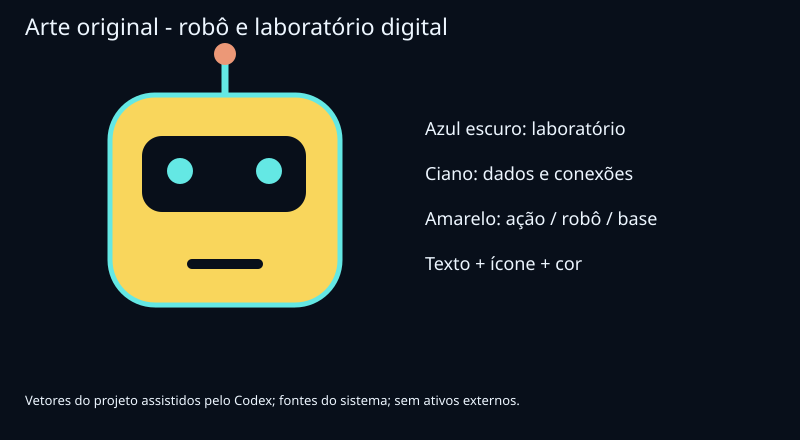

## 6. Fluxo do jogo

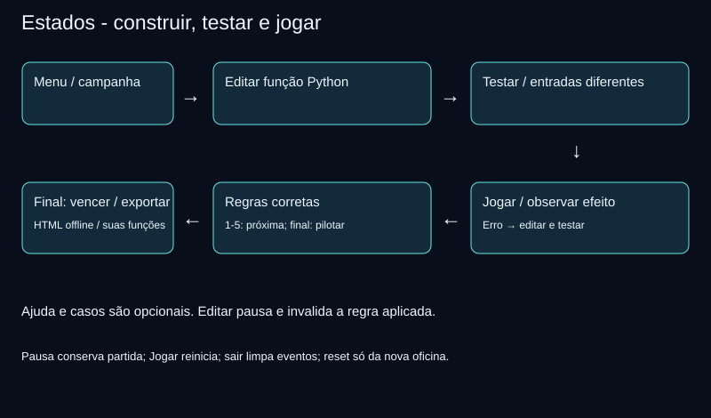

Menu oferece começar/continuar, missões e opções, versão/progresso. Reinício de campanha existente exige confirmação. Missões são liberadas em ordem; entrar abre editor/arena. Erro mantém tentativa. Regra aprovada nas missões 1–5 oferece próxima/replay. No final, abas permitem editar cinco fontes; testar projeto precede pilotar e vencer para exportar.

Ajuda/casos em diálogos com Escape e retorno de foco. Opções: texto maior, movimento reduzido, reset confirmado. Pausa/retomada no player; voltar à campanha encerra execução. Vitória disponibiliza conquista/download, sem etapa de questionário.

## 7. Level design

Seis mapas são desenhos de projeto gerados do conteúdo versionado, não screenshots. Arena, nave, entradas pelo topo, trajetória vertical e funções/casos definem o espaço. Posições 40/120/200 exemplificam onda inicial; mapas não representam todos os frames ou única solução. JSON contém entradas/resultados/fontes iniciais/referências.

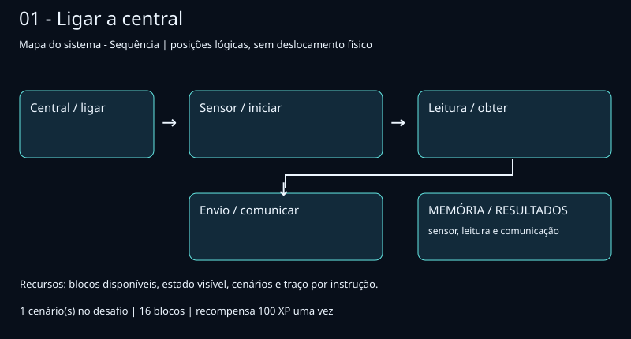

Controle invertido; ausência/simultaneidade de teclas distinguem regra geral de dois exemplos.

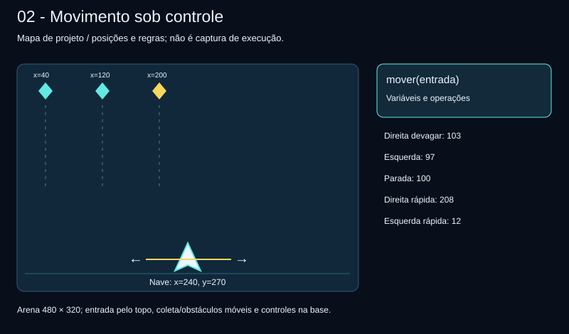

Deslocamento horizontal depende de posição, direção e velocidade; parada e velocidades diferentes impedem solução com distância fixa.

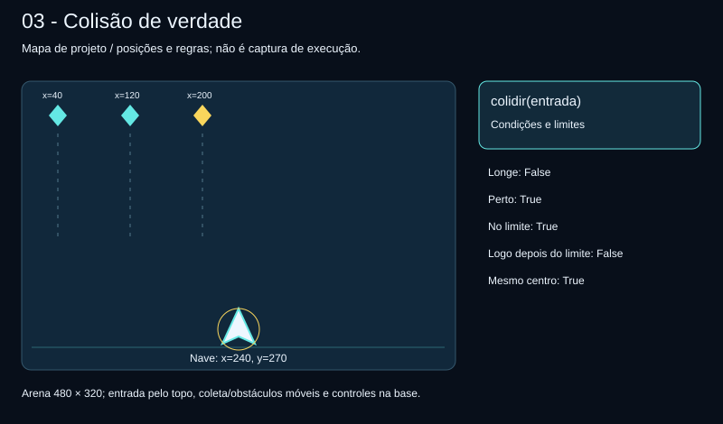

Raio indica limite de coleta/dano; fronteira exige igualdade. Anel é explicação de projeto, não elemento obrigatório do HUD.

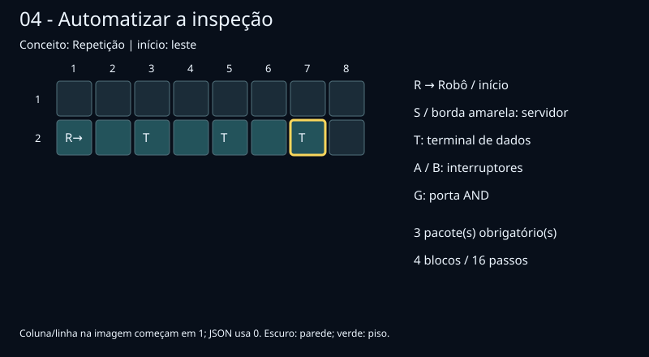

Cristais/estrelas alteram estado acumulado; outros conservam total. Redefinir pontos a cada objeto falha.

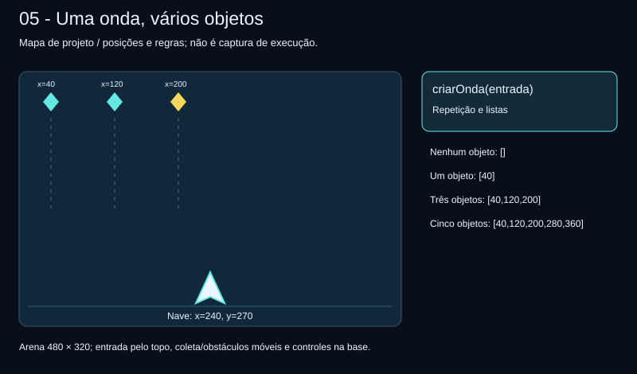

Repetição cria lista de posições espaçadas. Quantidade zero e 1/3/5 revelam objeto extra.

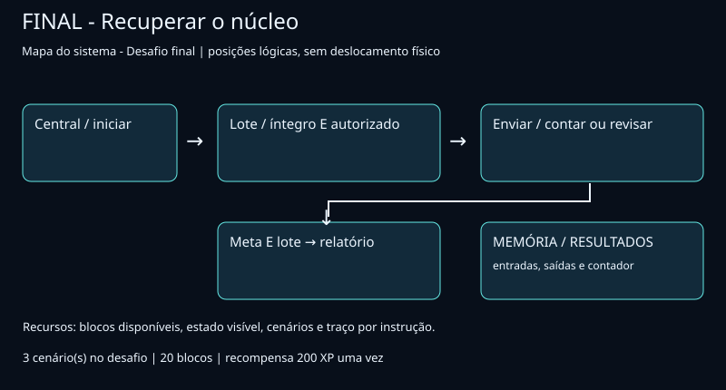

Cinco fontes salvas comandam cenário; composição de regras e pilotagem entre recompensas/pedras elevam desafio. Schema/semântica exigem seis missões na ordem, contratos/casos coerentes, referência que passa e fonte inicial que falha. JSON inválido bloqueia build; referência não preenche editor automaticamente.

## 8. Interface do usuário — UI/UX

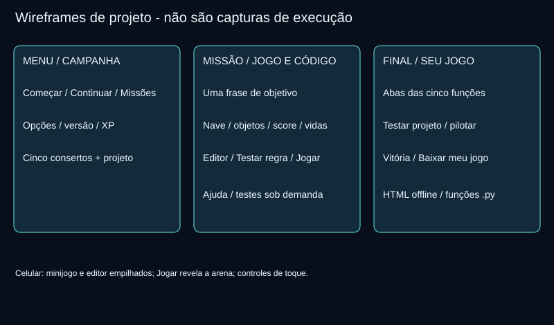

Paleta aprovada azul escuro/ciano/amarelo. Um objetivo, arena/HUD e editor; informação complementar sob demanda. HUD exibe pontos, vidas e estado real; animação mostra efeito do código. Editor mantém foco enquanto arena atualiza. Mensagens distinguem sintaxe, casos e resultado. Controles não são recriados por frame.

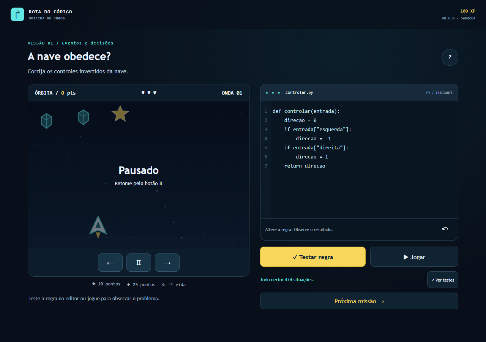

Captura real Chrome/Playwright, 12/10/2026, fonte 5ebdc64, build 0.6.0; não representa produção/playtest humano. O jogador altera valores da função e observa controles.

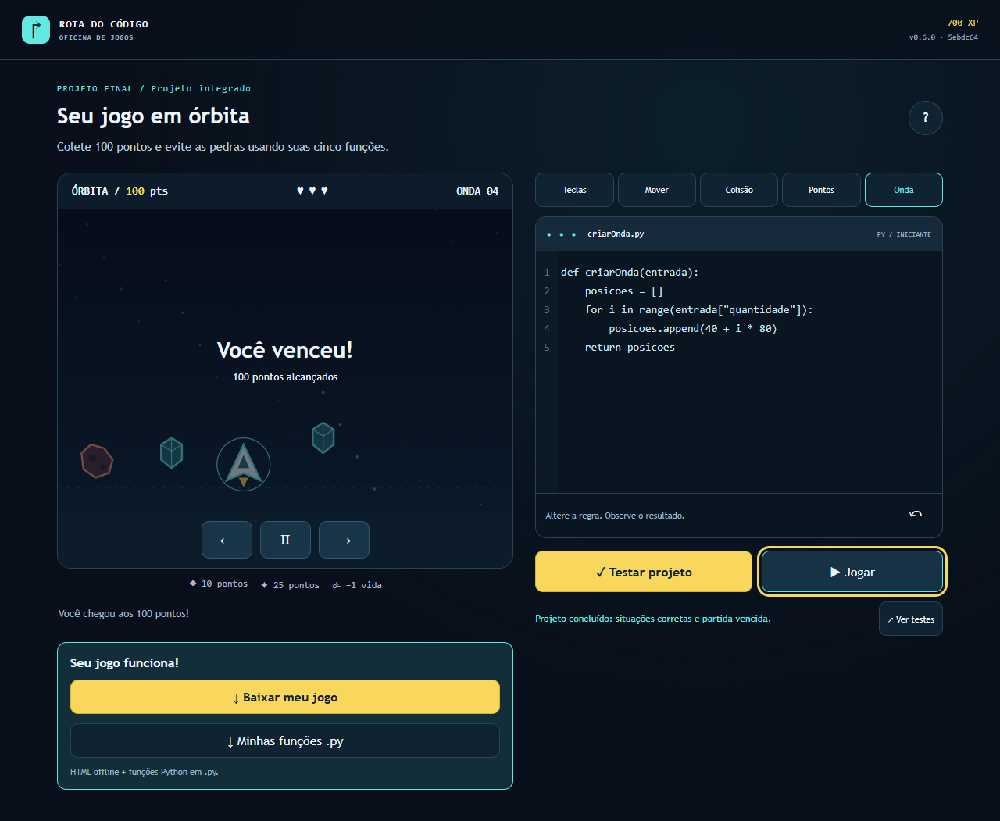

Mesma fonte/data: campanha pelo editor e partida pilotada pelos controles em teste automatizado, sem injetar progresso. Resultado de execução local.

Setas ou A/D pilotam fora do editor; toque usa botões de direção. Textarea nativo com numeração sincronizada. Tab insere quatro espaços, Enter mantém indentação e sugere nível após dois-pontos; Escape permite sair do editor para os controles. Foco visível, link para conteúdo, rótulos, texto/ícones além da cor, anúncios de eventos relevantes, sem anunciar cada frame. Blur limpa teclas; página oculta pausa. Texto maior/movimento reduzido ajustam preferências; objetos necessários ao gameplay continuam se movendo.

Em 390×844, arena/editor empilhados sem overflow horizontal nos testes; código longo rola dentro do campo. Jogar revela arena no celular. Alvos principais ≥44px, toque 48px. Testes de pausa/erros/menus/foco/campanha/toque/persistência/offline não certificam todos os aparelhos ou acessibilidade completa. P05: playtest por colegas de outra turma e revisão de clareza ainda pendentes.

### Referências geradas no Stitch — 13/10/2026

Produzimos menu/HUD/fim para desktop e celular no Stitch, com prompt da oficina aprovada. São referências conceituais e **não capturas de execução**. A conferência encontrou valores/assinaturas/fontes divergentes; não incorporamos seu HTML ao jogo. Contratos das seções4/6 e capturas reais prevalecem. [Origem, prompt, export e divergências](evidencias/stitch-ux.md).

Referência Stitch — menu desktop. Dados ilustrativos; divergências registradas na conferênciaUX.

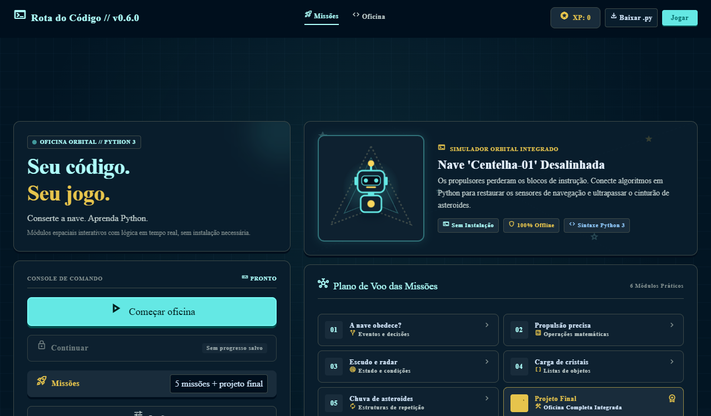

Referência Stitch — oficina desktop. Dados ilustrativos; divergências registradas na conferênciaUX.

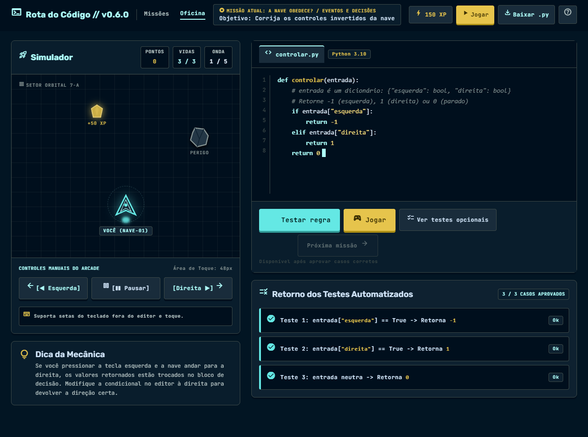

Referência Stitch — encerramento desktop. Dados ilustrativos; divergências registradas na conferênciaUX.

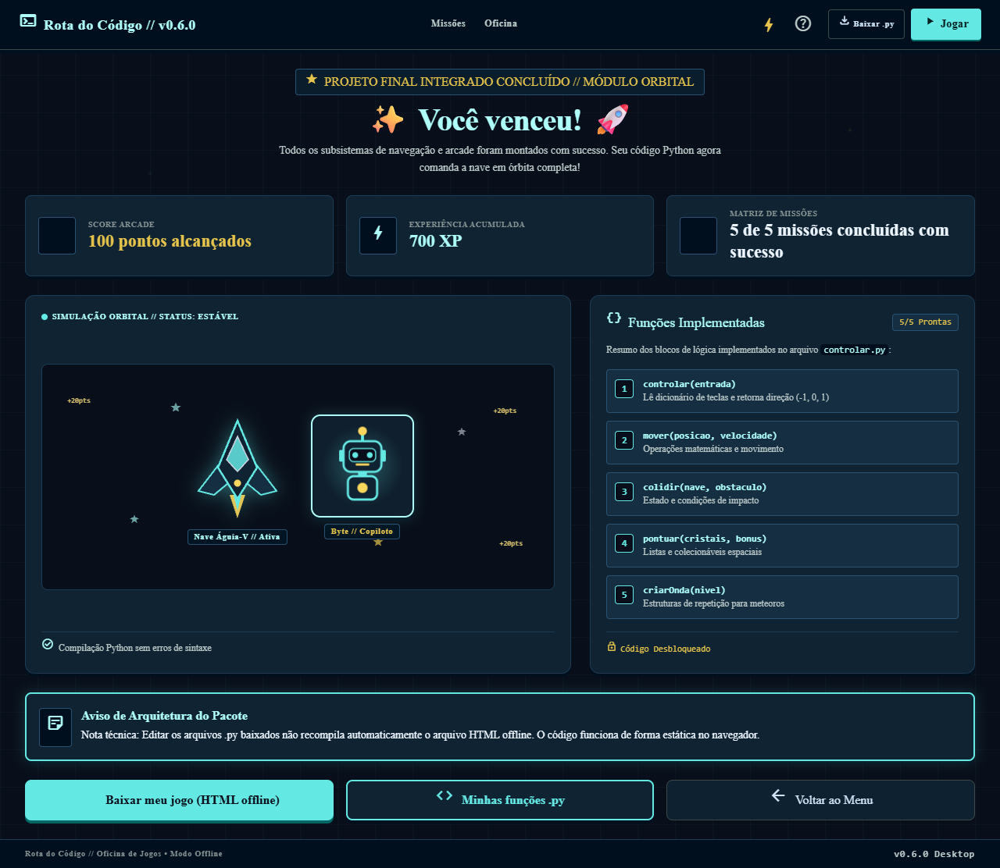

Referência Stitch — menu celular. Dados ilustrativos; divergências registradas na conferênciaUX.

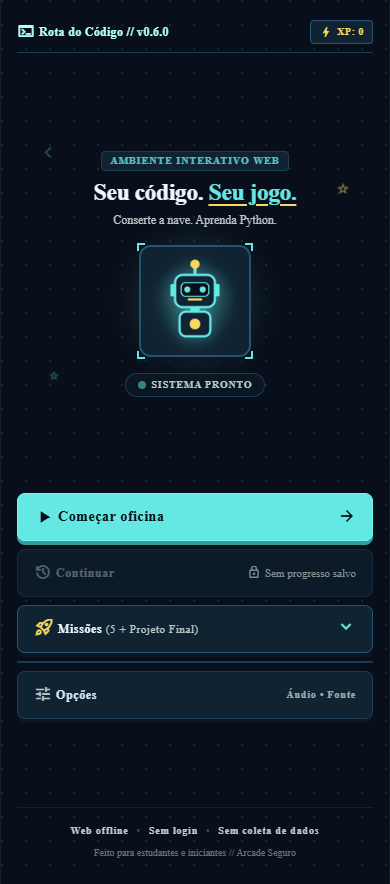

Referência Stitch — oficina celular. Dados ilustrativos; divergências registradas na conferênciaUX.

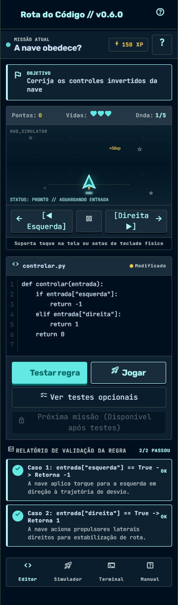

Referência Stitch — encerramento celular. Dados ilustrativos; divergências registradas na conferênciaUX.

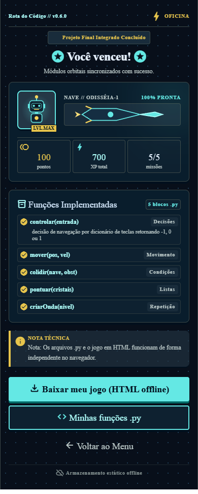

### Reconferência real da candidata — 13/10/2026

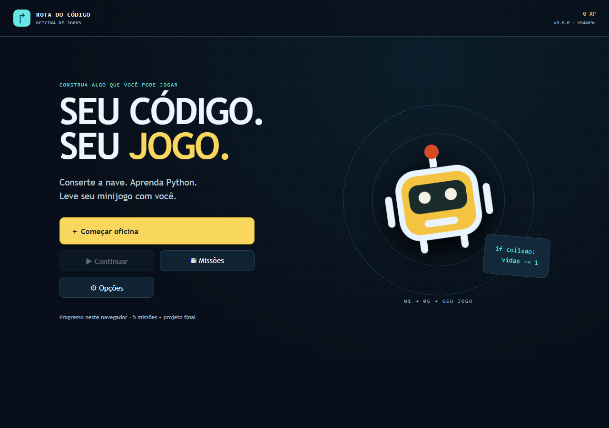

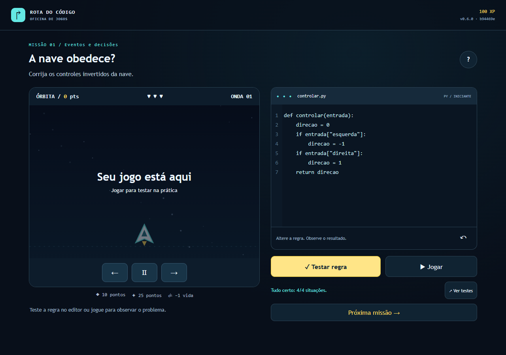

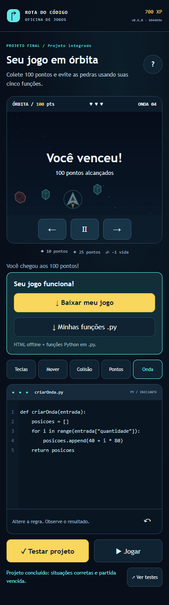

Capturas Chrome/Playwright, build0.6.0;17cenários passaram, incluindo teclado/editor, campanha/toque e exportação offline. Fonte/data/metadados em stitch-ux.md. Não representam produção ou playtest humano. Revisão de Desenvolvimento e compreensão dos quatro continuam pendentes; G1 não foi aceito pela IA.

## 9. Áudio e música

Ausência de trilha/efeitos/controle de volume. Feedback visual/textual. Áudio futuro exige origem/licença, controle e alternativa textual por PR.

## 10. Arte e referências visuais

Mascote/nave/objetos/ícones/mapas/wireframes/concept SVG/CSS originais, criados com assistência do Codex. PNGs anteriores e as imagens real-009 são capturas reais; PNGs em stitch-009 são referências de IA identificadas, sem integração ao site. Fontes Trebuchet MS/Consolas e alternativas locais, sem distribuição de arquivos de fonte ou CDN. Sem ativos copiados de jogos/modelo Word.

Referência de interação: relação direta entre código e resultado de um pequeno jogo. Não reproduz outro título nem declara eficácia educativa por referência. Versões anteriores/fontes consultadas permanecem no histórico; não descrevem mecânica ativa.

Referências técnicas: [esbuild](https://esbuild.github.io/api/#format), [Vitest](https://vitest.dev/guide/), [Playwright](https://playwright.dev/docs/test-assertions), [ambientes GitHub](https://docs.github.com/en/actions/how-tos/deploy/configure-and-manage-deployments/manage-environments) e [GitHub Pages](https://docs.github.com/en/pages/getting-started-with-github-pages/configuring-a-publishing-source-for-your-github-pages-site). Licenças/versões no lockfile/THIRD_PARTY/SBOM.

## 11. IA e componentes de terceiros

| Ferramenta / componente | Uso efetivo | Licença / condição |
|---|---|---|
| Codex | Requisitos/concepção/código/conteúdo/testes/arte vetorial/documentação | AI-USAGE; PR32 e PR33 revisados por Lucas; esta revisão documental no PR34 ainda exige revisão externa |
| Google Stitch | Referências menu/HUD/fim desktop/celular; export real sem integração ao jogo | Termos Google/IA; revisão humana pendente; THIRD_PARTY |
| TypeScript / esbuild | Tipos/empacotamento | Apache-2.0 / MIT |
| Ajv / Vitest / Playwright | Schema/regras/navegador | MIT / MIT / Apache-2.0 |
| Markdown-it / fflate | GDD/ZIP | MIT / MIT |
| ESLint / typescript-eslint / tsx | Lint/validação | MIT conforme inventário |

Transitividade/versões no THIRD_PARTY/lockfile/SBOM. Nenhuma dependência nova. Sem Opal, AI Studio ou IA em runtime. Stitch foi usado no009 para referências visuais; não gerou conteúdo avaliado em runtime. Golden eval específica de Opal/AI Studio não se aplica ao uso realizado. Comparação com CPython usa somente fixtures editoriais confiáveis em processo local/CI com timeout. Node VM testa pontes de exportação confiáveis que chamam a mesma AST. Não há CPython, execução remota ou exec/eval da fonte do jogador no navegador.

[Conferência técnica de direitos008](evidencias/direitos.md) e [inventário de ativos](evidencias/inventario-ativos-008.json) documentam origem/licenças e revisão coletiva pendente. Fontes incorporadas no PDF devem ser reconferidas por build; MIT do projeto não relicencia terceiros.

### Originalidade e direitos

Desenvolvemos o projeto para a atividade, com assistência de IA registrada em [AI-USAGE](../AI-USAGE.md) e componentes/ativos inventariados em [THIRD_PARTY](../THIRD_PARTY.md). O código próprio e o HTML exportado incluem a licença MIT. Em16/10/2026, Lucca confirmou em nome dos quatro a autoria/originalidade/titularidade e os direitos de uso dos materiais e ferramentas atuais. [Registro e limites](evidencias/confirmacao-squad-2026-10-16.md). A revisão formal do HEAD por outro autor permanece separada; não afirmamos assinatura dos quatro.

Não incluímos CPF ou assinaturas nos arquivos públicos. A entrega acadêmica não autoriza inscrição ou aceite dos termos do concurso opcional; eventual documento privado segue a orientação real do professor.

## 12. Ideias adicionais e próximos passos

[Revisão educativa013 e protocolo de playtest](evidencias/aprendizagem-conteudo.md): soluções alternativas verificadas em fonte/AST/exportação, casos de transferência e sessão sem explicação de três minutos preparada na etapa021. O [registro do playtest](evidencias/playtest.md) ainda não contém participante/resultado humano; nenhum ganho de aprendizagem ou diversão foi medido. Mecânica e 23 casos públicos preservados nesta revisão.

Implementado e mantido na versão 0.7.0: cinco missões Python/final, editor limitado/diagnósticos, testes públicos, minijogo real, menus/pausa/opções, 700 XP, fontes/vitórias persistentes, HTML exportável. Evidências em [jogo e testes](evidencias/python-pages.md), [baseline técnico](evidencias/baseline-tecnico.md) e [privacidade/segurança](evidencias/seguranca-inicial.md). Uma campanha ativa; versões anteriores recuperáveis no Git.

A participação dos quatro em pelo menos três INT está mapeada em contribuições e PRs revisados. Recuperação real incluindo Pages foi medida: manual80,66s e automática17,166s. Alertas e melhoria de MTTR foram demonstrados em ensaio isolado, mantendo o MTTR operacional sem amostra; não alegamos incidente espontâneo. Pitch86s com narração fornecida e legendas está produzido. A candidata1.0.0 precisa atravessar revisão, publicação, captura correspondente e triagem final. Avaliação educativa humana, demonstração ao vivo e banca permanecem ações presenciais; os testes por IA não as substituem. Novas funções, editor mais amplo, níveis e áudio são **roadmap futuro**. Nenhum resultado educativo ou incidente foi simulado como evidência. Esta revisão não altera a mecânica.

## Esteira

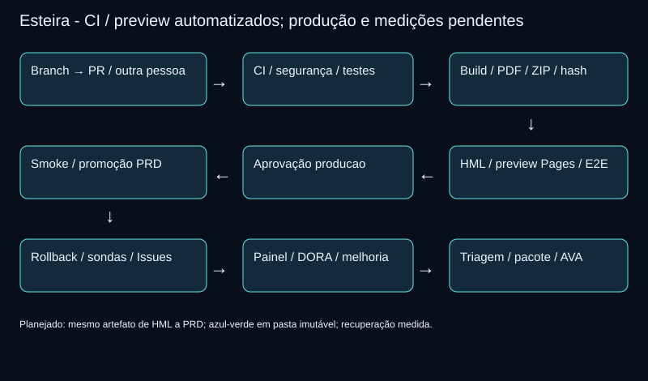

Repositório: https://github.com/luccalck/desafio-arcade . Main é a branch padrão protegida; PR exige CI e revisão por outra pessoa. Actions push/PR usa ubuntu-latest, npm ci/lockfile, lint, unidade/integração/conteúdo, E2E, Gitleaks, audit de produção, SBOM, reprodutibilidade, GDD/pdfinfo, relatório e ZIP/checksum. Mapas são regenerados ao converter o GDD. CI verde, isoladamente, não comprova implantação ou revisão humana.

Na execução [38829484114](https://github.com/luccalck/desafio-arcade/actions/runs/38829484114), a cadeia ci → deploy-hml → aprovação em producao → deploy-prd → monitor-pos-producao terminou com sucesso. Publicamos o mesmo ZIP em `/hml/` e `/releases/88d533e31452036092cd8edef3efa3c0775241dc/`, sem recompilar entre ambientes. O aceite HML registrou 216,414 s desde o merge comprovado; sete hashes HTTP por ambiente coincidiram com o ZIP original. A pipeline escreveu gh-pages e promoveu o ponteiro azul-verde após smoke da candidata; o smoke da raiz também passou. URL: https://luccalck.github.io/desafio-arcade/ . SHA-256 do ZIP: `84105e76a4bd55b5064d466340cb377ea27d49092bae984f65ebdeb7d0d0f937`.

[Configuração GitHub e ambientes](evidencias/configuracao-github.md): homologacao/producao estão limitados à main; produção exige reviewer e não permite bypass administrativo. Aprovação da implantação e revisão do PR são registros distintos. Sessão entre promoções, versão retirada e storage indisponível foram conferidos em navegador real. Os ensaios de recuperação manual38851754358 e automática38851915984 passaram em80,66s/17,166s, incluindo Pages, hashes, smoke e observação HTTP sem indisponibilidade na janela amostrada. A demonstração presencial na banca é distinta desses ensaios.

O monitor [38830013027](https://github.com/luccalck/desafio-arcade/actions/runs/38830013027) confirmou HTTP 200, latência e SHA em HML/PRD; CSV foi preservado em observabilidade e o painel https://luccalck.github.io/desafio-arcade/status/ foi validado em desktop/celular. Cron configurado em quinze minutos não garante pontualidade observada. Issues de alerta abriram e fecharam em alvo real temporário de ensaio (38/39 e45/46); não são incidentes espontâneos de produção. O MTTR operacional permanece sem amostra. Uma implantação em janela de catorze dias produz frequência de 0,0714286/dia, lead time de 5min27s e CFR 0%; uma amostra não demonstra melhoria causal frente à referência de onze dias.

Pipeline da tag final: submissao/GDD.pdf, LINK_DO_JOGO.txt, build.zip com LEIA-ME, pitch.mp4 com captura real de produção e MANIFESTO.sha256, seguidos de triagem real. O pitch de86s está produzido; seu vínculo à produção da candidata ainda impede chamar o pacote de final. Vídeo de produção entra antes da tag final; relatório recebe evidências de release/triagem depois dessas execuções. Data/versão/identificação/URLs devem ser reconciliadas com a release real. Prazo original 09/10/2026 até início da aula, horário não confirmado; prévia não retroagida. A publicação formal está validada; pacote final, nota e banca não são declarados aceitos.

Atualização técnica16/10/2026, sem mudança de mecânica: o PR34 acrescenta ensaio isolado de alertas e preparação de recuperação. Issues38/39 abriram/fecharam pelo Actions em alvo temporário do runner, separadas do MTTR de produção; produção88d533e preservada. As execuções posteriores de recuperação constam no registro operacional de16/10; esta preparação não é a evidência da execução. [Provas e limites](evidencias/ensaio-operacional-2026-10-16.md).

Atualização de comunicação16/10/2026: [pitch real com voz sintética](pitch/README.md) produzido com79,96s da produçãoe9/v0.7.0,legendas/créditos e fontes preservadas. Não é sessão humana ou comprovação de aprendizado; a futura submissão deve vincular vídeo eSHA da candidata aprovada sem misturar versões.

Edição corrente16/10: [pitch atual](pitch/README.md) tem86s,áudioElevenLabs fornecido porLucca e30blocos de legendaBold52px. A edição anterior79,96s permanece histórica. Origemvisuale9/v0.7.0e vínculo acadêmico final preservados.

Atualização da candidata1.0.0 em16/10: Davi aprovou o PR41 no HEADcea6745 e o merge4678830 integrou correções de reinício/alertas e melhoria medida. Lucca confirmou que os quatro integrantes atuais permanecem no squad sem alterações desde02/10; fonte e limites no registro de confirmação coletiva. Esta revisão do GDD/pitch e a mudança SemVer compõem uma candidata nova, sujeita à revisão e CI próprias. A gravação e9 permanece identificada como0.7.0, sem atribuição falsa à futura produção1.0.0.

Exceção operacional de19/10: dispensamos a revisão externa doPR47 por orientação expressa do proprietário. A autorização técnica daRelease fica limitada aov1.0.0/SHAconfigurado e conserva approved:false no manifesto; não é aprovação humana ou garantia de nota. Os testes, hashes, origem da produção, aprovação doenvironment e demais controles permanecem. A triagem mantém o prazo antigo e a data real, podendo reprovar temporalmente sem impedir o arquivamento do pacote efetivamente gerado.
