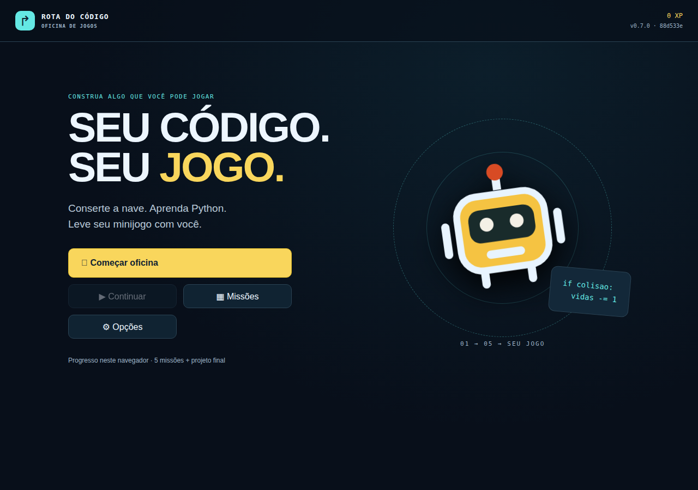
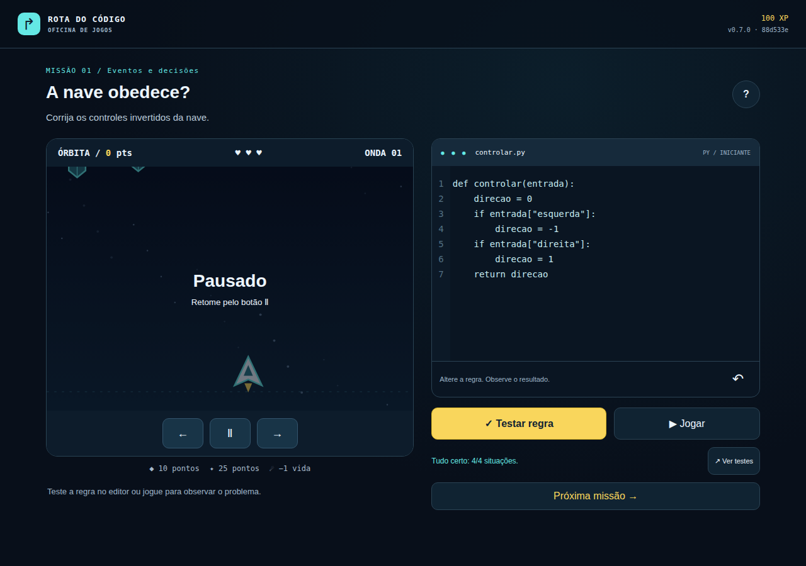

# Relatório Técnico — Desafio Arcade

**Rota do Código · Squad Aura 67 · Fechamento operacional {{VERSION}} · 19/10/2026**

## 1. Síntese, identificação e alcance

Construímos uma oficina educativa WEB em que o jogador corrige cinco funções Python, testa diferentes entradas e usa suas regras num minijogo de nave. O produto é estático, responsivo, exportável e jogável offline pelo método documentado. A avaliação de Dev Ops exige que esse produto atravesse Git, testes, segurança, homologação, aprovação, produção e acompanhamento com rastreabilidade.

**Repositório:** [luccalck/desafio-arcade](https://github.com/luccalck/desafio-arcade). Publicamos a versão **1.0.0**, SHA `be281493c7699468f991a2333df074ec76691b3d`. A [Esteira 39346940628/1](https://github.com/luccalck/desafio-arcade/actions/runs/39346940628) concluiu com sucesso: **325 testes (152 de unidade e 173 de integração) e 37 E2E**, quatro cenários HML, 173,519 segundos até a homologação, aprovação de produção por `luccalck`, smoke e monitor verdes. O ZIP tem 30.469 bytes; verificamos os 173 arquivos do bundle original. O pitch de 86 segundos filmou essa produção e passou na [validação 39348162168](https://github.com/luccalck/desafio-arcade/actions/runs/39348162168).

A revisão externa do fechamento foi dispensada pelo proprietário. A exceção registra `approved:false`; não equivale a revisão humana ou ao atendimento integral desse critério. Mantivemos o prazo antigo e a data real da execução. Ensaios anteriores mediram recuperação em 80,66 s e 17,166 s, e variação de 3 s para 2,5 s no MTTR do ensaio. Esses resultados não são incidentes espontâneos nem sessões humanas.

| Integrante | RA | Coordenação | GitHub |
|---|---|---|---|
| Lucca Castilho Costa | 26179873 | Produto e Game Design | luccalck |
| Davi Marcondes Paes de Souza | 26180842 | Desenvolvimento e Qualidade | Davi Souza78 |
| Miguel Oliveira de Almeida | 26179933 | Plataforma e Release | miguelsenai2024 |
| Lucas Souza da Silva | 26179875 | SRE e Segurança | 6lucassilvaaa |

Os papéis coordenam o trabalho, sem exclusividade de área. Preservamos a autoria dos commits; os quatro precisam defender suas contribuições na banca. O nome completo e RA de Lucca foram fornecidos pelo próprio integrante em 14/10. Não incluímos CPF, assinaturas ou credenciais.

### Marcos e fontes de referência

|Marco|Fonte verificável|Resultado e alcance|
|---|---|---|
|Auditoria 0.6.0|[CI 38649548723](https://github.com/luccalck/desafio-arcade/actions/runs/38649548723), e71de72|260 testes/36 E2E; histórico anterior aos deploys|
|Primeira HML 0.7.0|[Run 38674290799](https://github.com/luccalck/desafio-arcade/actions/runs/38674290799),773af17|HML 4/4; falha real do coletor; 191 s reconstruídos depois|
|Correções revisadas|[PR 35](https://github.com/luccalck/desafio-arcade/pull/35), [PR 33](https://github.com/luccalck/desafio-arcade/pull/33)|Dois commits de Miguel preservados; revisão de Lucca; Lucas aprovou a consolidação|
|Entrega técnica formal|[Run 38829484114](https://github.com/luccalck/desafio-arcade/actions/runs/38829484114),88d533e|299 testes/36 E2E; HML 4/4; 216,414 s; PRD aprovada e smoke verde|
|Sondas pós-produção|[Run 38830013027](https://github.com/luccalck/desafio-arcade/actions/runs/38830013027)|HML/PRD 200, ambas 0.7.0/SHA 88; DORA com uma amostra|

Datas seguem America/Sao_Paulo. Produção 1.0.0 observada em 19/10, às 21:24:09 (20/10, 00:24:09 UTC). Fontes datadas de 15–16/10 são históricas; não transferimos seus hashes ao novo SHA. Não declaramos nota, F, playtest humano, AVA ou banca realizados.

<div style="break-before: page;"></div>

## 2. Produto educativo e experiência do jogador

O problema é memorizar comandos sem compreender como uma regra altera um programa. O público é iniciante em programação, com leitura básica em português e familiaridade com teclado ou toque. O objetivo é construir, testar e depurar funções que resolvem um comportamento observável, em vez de apenas seguir uma sequência de cliques.

| Missão | Conceito | Ação e condição de conclusão |
|---|---|---|
|1 — Controlar|Eventos e decisões|Corrigir direção conforme teclas; quatro casos públicos|
|2 — Mover|Operações e parâmetros|Posição + direção × velocidade; cinco casos|
|3 — Colidir|Comparação e fronteira|Distância ≤ raio, incluindo igualdade; cinco casos|
|4 — Pontuar|Estado e condições|Conservar acumulado e somar valor do item; cinco casos|
|5 — Criar onda|Lista e repetição|Quantidade exata, início 40 e intervalo 80; quatro casos|
|Final — Órbita|Integração e depuração|Aplicar cinco funções, passar 23 casos e atingir 100 pontos com três vidas|

O ciclo é editar, testar entradas, observar a partida e corrigir. Nas primeiras missões, funções auxiliares corretas isolam o conceito. O final combina as cinco fontes do jogador. Ajuda e detalhes dos testes ficam sob demanda; menus, progresso e XP organizam a campanha. Repetir missão não duplica recompensa.



**Figura 1.** HML pública capturada em 15/10/2026, 21:29:25, America/Sao_Paulo; versão 0.7.0, SHA 88d533e, viewport 1280×900. Origem/tempo/versão em hml-88-menu.json, produzidos pelo navegador durante a regressão real.

A experiência WEB atende computador e celular. Em 16/10, três agentes de IA exploraram desktop, toque e acessibilidade pelainterface. A avaliação desktop encontrou aviso de derrota após reiniciar; corrigimos e verificamos regressão antes/depois, posteriormente publicada e mantida na 1.0.0 (Issue 42). Toque não encontrou bloqueante; acessibilidade preservou capturas e verificações separadas, mas perdeu o log completo por erro da ferramenta. [Provas e limites](evidencias/avaliacoes-ia-2026-10-16.md). Esses agentes conhecem programação e não comprovam aprendizagem/diversão humana. A sessão de colega de outra turma na banca continua sem evidência.

<div style="break-before: page;"></div>

## 3. Arquitetura do jogo e funcionamento offline

A aplicação usa TypeScript, HTML/CSS/SVG e esbuild. A camada visual não decide as regras pedagógicas: o núcleo recebe entradas e devolve resultados, permitindo testar lógica e contratos sem depender da tela. O conteúdo JSON é validado antes de compilar; conteúdo inválido precisa interromper a build.

| Componente | Responsabilidade | Fronteira verificável |
|---|---|---|
|src/core|Estado, regras, compilação/interpretação e contratos|Entradas, saídas, fronteiras e limites testáveis|
|src/scenes|Menu, editor, arena, feedback e navegação|E2E por teclado/toque; regras fora da apresentação|
|src/content|Conteúdo educativo e missões|JSON validado e contratos de aprendizagem|
|pages|Carregador e contrato de rollout|Seleção de release e versão preservada na sessão|
|scripts|Build, empacotamento, publicação e observação|Contratos e falhas separados do produto|
|tests|Unidade, integração e E2E|JUnit/cobertura e artefatos por execução|

### Python pedagógico e limites

O jogador escreve funções Python dentro de um subconjunto delimitado. O analisador produz AST; o interpretador executa condições, operações, listas, atribuições e repetição limitada. Não é CPython completo: imports, classes, bibliotecas arbitrárias e acesso ao DOM/rede não fazem parte do contrato. Não usamos eval/Function para executar a fonte do jogador.

Há limites de fonte, nós, profundidade, passos e iterações. Saídas inválidas interrompem a partida com diagnóstico. Editar pausa e invalida o aceite da regra anterior; retomar exige aplicar a fonte nova. Vitória/derrota são estados finais tratados pelo motor. Esses controles reduzem falhas previsíveis sem prometer segurança absoluta de qualquer entrada.

### Exportação e alternativas técnicas

Concluir o projeto permite baixar HTML independente e funções .py. O HTML inclui motor/AST e compartilha semântica com a oficina. O arquivo .py é estudável num Python convencional; alterá-lo não recompila automaticamente o HTML exportado. Preferências/progresso ficam no navegador, sem conta ou backend. O jogador não precisa instalar Python ou engine.

| Escolha | Justificativa | Alternativa considerada e limite |
|---|---|---|
|DOM/SVG e TypeScript|Escopo pequeno, UI navegável e regras testáveis|Engine web seria válida, mas acrescentaria integração sem necessidade demonstrada|
|Subconjunto Python local|Cinco funções curtas, operação offline e sem execução remota|CPython/WASM ampliaria compatibilidade; não houve benchmark comparativo|
|Site estático Pages|Sem backend, VM ou nuvem paga; ZIP distribuível|Execução remota exigiria infraestrutura e impediria o método offline|
|Vitest/Playwright|Regras, contratos, navegador e exportação|Cobertura/contagens não substituem revisão e playtest|

O método offline é descompactar o ZIP original e abrir index.html, conforme LEIA-ME.txt. Não há API de IA em runtime, cadastro ou telemetria. Os testes offline atuais são apresentados com origem e hash na página seguinte.

<div style="break-before: page;"></div>

## 4. Proveniência, ZIP promovido e teste offline

A [run 39346940628/1](https://github.com/luccalck/desafio-arcade/actions/runs/39346940628) produziu a entrega 1.0.0/be28149. Conferimos173 arquivos do bundle original. O mesmo ZIP foi aceito em HML e promovido para PRD; recibos preservam SHA/run/tentativa e checksum, sem recompilar entre ambientes.

**ZIP promovido:**30.469 bytes, SHA-256 `bbb63fde0a8808e7b9765b76fd5900b955534d5e6083202d0a1cfe85c27f5b9d`, inferior a 25 MB. Sete arquivos publicados foram comparados com o ZIP antes da captura. A reprodução determinística confirmou dois ZIP s idênticos. Fontes atuais em docs/evidencias/entrega-1.0.0-2026-10-19/.

A captura real percorreu cinco missões, 23 casos, vitória 100 pontos / 700 XP e downloads .py/HTML. O HTML exportado abriu offline, sem requisições externas. Os E2E da CI incluem o pacote offline. A figura abaixo é uma prova histórica preservada do SHA 88; não é captura da 1.0.0.


**Figura 2.** Vitória capturada durante execução file:// do ZIP original do SHA 88, versão 0.7.0, em 15/10/2026, 21:31:52, America/Sao_Paulo. A prova pertence ao pacote histórico88d533e; não é atribuída à entrega 1.0.0.

O bundle associa SHA/run/tentativa ao inventário e verifica nomes, tamanhos, SHA-256 e version.json externo contra o empacotado. Reexecuções não podem misturar tentativas. A data de origem é estável para o mesmo SHA; horários reais ficam no Actions/recibos. Na referência anterior 773af17, o ZIP original e os sete arquivos HTTP também foram conferidos; esse histórico é preservado, mas os hashes antigos não são atribuídos à produção do SHA 88.

<div style="break-before: page;"></div>

## 5. Esteira CI/CD e governança dos estágios

O fluxo mantém uma cadeia entre mudança, aprovação, artefato e versão observada. A fronteira operacional avançou para produção aprovada, ensaios reais de alertas e recuperação; falta a submissão acadêmica e os aceites específicos restantes. A falha temporal anterior foi corrigida por PR revisado, sem ignorar o gate.

```text
branch → PR/revisão/CI → main protegida
  → build/ZIP + PDFs + SBOM/relatórios + manifesto
  → /hml/ + E2E + medição temporal
  → aprovação environment producao → release imutável
  → smoke → promoção azul-verde ou recuperação
  → sondas/Issues/status/DORA → vídeo validado → submissão/triagem
```

| Etapa | Contrato implementado | Prova exigida |
|---|---|---|
|Qualidade|npm ci, lint/tipagem, conteúdo, Vitest/cobertura|Logs, JUnit, cobertura e falha bloqueante|
|Segurança|Gitleaks, audit de produção, SBOM|Relatórios do mesmo SHA/run/tentativa|
|Build|Estático, reprodutibilidade, GDD/relatório PDF, ZIP|Version.json, checksum, pdfinfo/texto|
|E2E|Campanha, teclado/toque, exportação/offline|JUnit, capturas e arquivos reais|
|Pacote CI|Consolidar identidade e inventário|ci-manifest.json com tamanhos/hashes|
|HML/PRD|Consumir bundle sem recompilar|Recibos, aprovação, E2E/smoke e hashes HTTP|
|Submissão|Aguardar produção/release e vídeo fixado|Pacote completo e triagem real na tag correta|

Qualidade, segurança, build e E2E executam em jobs independentes de ubuntu-latest; o gate CI depende de seus resultados. Há lockfile e cache npm. GDD.pdf e Relatorio Tecnico.pdf entram no bundle; pdfinfo/pdftotext verificam abertura/texto e o relatório deve ter de 1 a 12 páginas. A fonte continua versionada para revisão, sem substituir o GDD completo pelo relatório.

A consolidação corrigiu lacunas reais: relatório antes fora da CI, submissão concorrente com produção, proveniência insuficiente, seleção de vídeo pela última execução e triagem agendada sem recuperar pacote. Agora o vídeo é fixado por SHA/run/tentativa/digest, e o pacote depende de produção/release. Um HTTP 200 isolado não pode substituir a validação de ZIP, PDF, vídeo e manifesto.

Azul-verde separa candidata e estável; o carregador preserva uma versão válida por sessão. Gh-pages é escrita pela pipeline, sem edição manual para contornar a falha. Environments mantêm aprovação/políticas de refs/tags. Pages Actions publica a árvore gh-pages preservada, sem recompilar: equivalência técnica justificada e validada por hashes/smoke, declarada frente à origem literal do exemplo. Uma aprovação de PR não substitui a de produção nem se transfere para HEAD alterado.

O PR 32 recebeu revisão externa de Lucas no HEAD 59dc830 e foi integrado. O PR 35 incorporou dois commits autorais de Miguel, revisados por Lucca; Lucas aprovou a consolidação f38 no PR 33 antes do merge 88. A aprovação do environment producao por Lucca foi registrada conforme a política existente. Não simulamos outro revisor ou autoaprovação. No fechamento doPR47, o proprietário dispensou a revisão externa; a exceção registra approved:false, mantém CI e restaura a política de revisão após integrar. Essa exceção não comprova o critério acadêmico de revisão.

<div style="break-before: page;"></div>

## 6. Qualidade, testes e correção de defeitos

Os resultados pertencem ao SHA e à execução indicada. Uma suíte local/CI não comprova implantação. Mantemos regras separadas da renderização, testes de fronteira/contratos inválidos e integridade do pacote.

| Fonte | Unidade/integração | E2E | Alcance |
|---|---:|---:|---|
|[CI 38649548723](https://github.com/luccalck/desafio-arcade/actions/runs/38649548723), e71de72|260=152+108|36|Referência 0.6.0; bundle auditado|
|[Run 38674290799](https://github.com/luccalck/desafio-arcade/actions/runs/38674290799),773af17|270|36|CI 0.7.0 verde; HML depois falhou na medição|
|[CI 38674970174](https://github.com/luccalck/desafio-arcade/actions/runs/38674970174),78c367d|273|36|Push da correção PR 33; sucesso|
|[CI 38674975441](https://github.com/luccalck/desafio-arcade/actions/runs/38674975441), PR 33|273|36|Validação de PR, sem deploy formal|
|[CI 38829484114](https://github.com/luccalck/desafio-arcade/actions/runs/38829484114),88d533e|299|36|HML 4/4, PRD formal e smokes aprovados|
|[Main 1.0.0](https://github.com/luccalck/desafio-arcade/actions/runs/39346940628), be28149|325|37|Entrega atual; HML/PRD/monitor SUCCESS|
|Histórico773: HML pública em 15/10|—|4|Desktop/toque, campanha e reinício; 62,009 s|

No bundle do SHA 88, ci-88-coverage.json mede src/core: 468/478 instruções (**97,90%**), 128/128 linhas (**100%**), 54/54 funções (**100%**) e 320/336 ramificações (**95,23%**). Os JUnit confirmam 299 testes sem falhas em 2,580 s e 36 E2E sem falhas em 67,838 s. A regressão HML 4/4 levou 67,882 s; o smoke PRD 1/1 também passou. Supera os mínimos 15/3/2 e 70% do core com origem remota identificada. Os 53 testes locais de recuperação/alertas continuam provas de contratos, não ensaio real.



**Figura 3.** Smoke real da produção em 15/10/2026, 21:31:47, America/Sao_Paulo; 0.7.0, SHA 88d533e. O navegador abriu a release do SHA correto e verificou editor, movimento e pausa; prd-88-tela.json preserva origem, horário e viewport. É teste automatizado, não playtest humano.

O bug histórico de regra antiga permitia retomar usando compilação anterior após editar. A correção invalida aceite/fingerprint e exige aplicar fonte nova; existem captura, JUnit da falha e regressão em docs/evidencias/bug-regra-antiga.md e tests/e2e/workshop.spec.mjs. [PR de contexto](https://github.com/luccalck/desafio-arcade/pull/8). O defeito temporal HML também gerou três regressões: antes 3 falhas/8 passes; depois 11 passes. Não criamos bug ou incidente fictício para atender rubrica.

<div style="break-before: page;"></div>

## 7. Homologação medida e produção formal aprovada

A correção percorreu revisão real: o PR 35 preservou dois commits de Miguel e recebeu aprovação de Lucca. Lucas aprovou o HEAD f38f6d9 da consolidação no [PR 33](https://github.com/luccalck/desafio-arcade/pull/33), integrado na main como 88d533e31452036092cd8edef3efa3c0775241dc. A [run 38829484114](https://github.com/luccalck/desafio-arcade/actions/runs/38829484114) concluiu com sucesso, incluindo CI, HML e produção. A política de aprovação e as proteções foram preservadas.

|Marco / fonte|Registro verificável|Resultado|
|---|---|---|
|Merge PR 33 / API|16/10, 00:26:22 UTC = 15/10, 21:26:22 local|SHA 88 e base main conferidos|
|E2E HML / hml-88-tempo.json|00:29:58,414 UTC|4/4 cenários; 216,414 s após publicação do merge|
|Aceite HML / hml-88-aceite.json|00:29:59,167 UTC|Sete hashes e ZIP vinculado a SHA/run/tentativa|
|Aprovação / prd-88-recibo.json|Environment producao; revisor luccalck; approved|Aprovação real conforme política existente|
|Smoke candidata|00:31:28,612 UTC; passed=true; errors=[]|Release 88 testada antes da promoção|
|Smoke raiz e recibo|00:31:47,097/460 UTC; state=publicada|Raiz redireciona à release88 e passa smoke|

**Entrega 1.0.0:** merge em 19/10, às 21:19:18; HML aceita às 21:22:12;173,519 s. PRD observada às 21:24:09, approval luccalck, smoke correto e ZIP bbb63fde. Recibos originais no conjunto de evidências da entrega.

### Origem temporal e limite de quinze minutos

O coletor agora usa o merged_at do PR integrado, exigindo merged=true, base main e merge_commit_sha exato. Confere payload de push e objeto remoto de tags quando aplicável; Events é complementar. Data do commit do desenvolvedor e criação do run não substituem publicação. O recibo atual registra **216,414 segundos — 3 min 36,414 s**, abaixo de 900 s, com fonte GitHub, SHA e run/tentativa identificados.

A primeira execução 773af17 continua registrada como falha do coletor: a regressão passou, mas o feed Events atrasado não trouxe o Push Event na janela. A reconstrução histórica de 191 s não alterou aquela conclusão. O GitHub documenta latência de 30 segundos a 6 horas nesse feed. [Fonte oficial](https://docs.github.com/en/rest/activity/events#list-repository-events). O novo sucesso decorre de correção revisada e execução posterior, sem ignorar o gate.

### Promoção e fronteira do aceite

O deploy-prd usou o mesmo ZIP aceito em HML, SHA-256 84105e76…d0d0f937. O recibo identifica ator luccalck, run 38829484114/1 e estado publicada às 21:31:47 de 15/10, horário de São Paulo. A URL imutável `/releases/88d533e31452036092cd8edef3efa3c0775241dc/` e a raiz foram testadas; `/status/` responde HTTP 200. Isso comprova produção técnica, não rollback, GitHub Release acadêmica, pitch ou triagem final.

Lucas aprovou o PR 34 no HEAD e9dd28c. A tag v0.7.0 desse SHA percorreu CI/HML/PRD/sondas na run 38852413982/2; HML em 745,303 s desde o push original. O publicador falhou ao buscar o draft por tag. Regressão reproduziu o erro; a correção revisada por Lucas no PR 40 foi integrada como 1e3dd3b. Sua main passou em 318 testes/36 E2E e HML em 178,827 s; a PRD ficou skipped intencionalmente para preservar e9.

A [retomada 38940532129](https://github.com/luccalck/desafio-arcade/actions/runs/38940532129), aprovada no environment, conferiu nove gates originais, proveniência e versão pública, e publicou os mesmos anexos em 16/10, às 14:33:57 local. Os seis downloads públicos e cinco hashes do inventário coincidem com o bundle original. A [Release técnica](https://github.com/luccalck/desafio-arcade/releases/tag/v0.7.0) está acessível; as falhas anteriores permanecem no histórico. Nenhum build ou deploy foi refeito pela retomada. O PDF nela anexado pertence à origem e9; este relatório posterior é um candidato documental separado, sem sobrescrever anexos imutáveis.

<div style="break-before: page;"></div>

## 8. Sondas, alertas, recuperação e DORA

As [sondas 39348785870](https://github.com/luccalck/desafio-arcade/actions/runs/39348785870) confirmaram, após a tag, HML HTTP 200 / 162,810 ms e produção HTTP 200 / 97,040 ms, ambas 1.0.0/be28149. CSV e JSON originais estão no conjunto da entrega. A sonda mede o documento HTTP, incluindo corpo; cron de 15 min pode atrasar e não é SLA. O painel foi testado em desktop e 390 px, com quatro cartões, atualização e atalho de conteúdo; isso não é auditoria humana completa de acessibilidade.

|DORA / janela de 14 dias até 20/10, 00:38:15 UTC|Valor observado|Denominador / limite|
|---|---|---|
|Frequência|0,285714 deploy/dia|4 versões formalmente implantadas / 14 dias|
|Lead time|0,339167 h = 20 min 21 s|4 vínculos entre commit e fim do deploy-prd|
|Taxa de falha|25%|1 rollback planejado entre 4 deploys|
|MTTR operacional|null; samples=0|Sem Issue operacional elegível aberta/fechada|

O lead time médio atual equivale a 0,014132 dia, diante dos 11 dias do enunciado. A amostra anterior tinha média 35 min 19 s; não inferimos causalidade ou melhoria sustentada. O coletor conta deploy-prd confirmado mesmo se anexos falharem depois. O rollback planejado afeta a taxa bruta sem constituir incidente espontâneo. Tempos de ensaio são separados do MTTR operacional.

A [vigilância 39350305105](https://github.com/luccalck/desafio-arcade/actions/runs/39350305105) passou em 19/10: pacote exato por ID/digest, PDF/seções, vídeo, manifesto e smoke público. O resultado registra `formalDeliveryApproved:false`. Mantivemos o cron diário e o alerta em falha habilitados; uma execução manual não comprova os agendamentos futuros. A tentativa39350063593 falhou no executor; o ajuste posterior usa CLI direto, timeout e logs, sem remover verificações.

### Dois alertas reais em ensaio isolado

[Run 38847296363](https://github.com/luccalck/desafio-arcade/actions/runs/38847296363): servidor temporário no runner respondeu 404 e atrasou 2,2 s por HTTP. Issues 38/39 abriram e fecharam automaticamente em 1 s/3 s, média de 2 s do ensaio. Duas sondas por falha não duplicaram Issues. Labels/marcadores próprios separam esses ciclos do MTTR de produção. Na execução posterior 38950333359, correção 432eb57, as Issues 43/44 receberam automaticamente alerta + ensaio, sem duplicação, e fecharam em 2 s/4 s: média de 3 s no ensaio. A classificação completa passou de 0/2 para 2/2. O tempo anterior era 2 s; não houve ganho de velocidade comprovado. O filtro por marcador preserva MTTR operacional N/D. A partir da média de 3 s, retiramos consultas redundantes de labels: 12 no teste anterior contra 2 no contador real. No ensaio 38953734834, Issues 45/46 fecharam em 1 s/4 s, média 2,5 s, redução observada de 16,7%. São duas amostras por execução, com resolução de 1 s e variação de runners/API; sem generalização para produção. [Fontes e método](evidencias/melhoria-mttr-2026-10-16.md).

Na tentativa 38846941358, listagem atrasada duplicou Issues. Uma regressão reproduziu a falha; preservar escritas confirmadas reduziu 2 → 1 Issue por duas sondas na repetição real. Mantivemos a tentativa falha no histórico.

### Recuperação real e continuidade observada

[Manual 38851754358](https://github.com/luccalck/desafio-arcade/actions/runs/38851754358): aprovação, Pages, sete hashes e smoke; **80,66 s** do dispatch ao smoke, incluindo fila/aprovação. Foram 171 respostas HTTP 200. [Automática 38851915984](https://github.com/luccalck/desafio-arcade/actions/runs/38851915984): candidata acb aprovada, falha apenas no observador, rollback real/Pages/sete hashes/smoke em **17,166 s**; 65 respostas HTTP 200. A run ficou vermelha pela injeção; os steps de recuperação passaram. Amostras discretas não garantem os intervalos entre consultas.

A sessão existente permaneceu na baseline nas promoções; sessão nova e storage indisponível abriram e9. A sonda pós-tag bloqueou a primeira tentativa; depois de correção/revisão, a Release foi publicada na retomada. Fontes: operacao-release-2026-10-16/ e fechamento-independente-2026-10-16/. Esses ensaios não substituem playtest humano ou banca.

<div style="break-before: page;"></div>

## 9. Rastreabilidade dos dez integráveis

Cada fonte identifica execução ou PR real. A matriz separa aceite técnico comprovado de atividades finais: produção verde não significa aprovação de todos os integráveis ou entrega acadêmica completa.

|INT / peso A|Fonte verificável|Implementado ou executado|Aceite ainda necessário|
|---|---|---|---|
|INT-01 /10%|[PR 47](https://github.com/luccalck/desafio-arcade/pull/47), matriz individual|Quatro autores/RAs;20PRs revisados;≥3 INT por pessoa; tag anotada 1.0.0|Revisão final dispensada, sem APPROVE; banca/F ainda não avaliados|
|INT-02 /8%|[Tag/CI](https://github.com/luccalck/desafio-arcade/actions/runs/39348283211)|GDD 1.0.0 completo,19 p,12seções e Esteira; PDF automático|Revisão documental posterior identificada, sem alterar PDF imutável|
|INT-03 /15%|[Main verde](https://github.com/luccalck/desafio-arcade/actions/runs/39346940628)|CI→HML 173,519 s→aprovação PRD→smoke→monitor; tag HML 200,367 s|Jobsubmissao da tag reprovou; não atribuímos sucesso global àtag|
|INT-04 /12%|[CI 325/37](https://github.com/luccalck/desafio-arcade/actions/runs/39346940628),[PR 8](https://github.com/luccalck/desafio-arcade/pull/8)|325 testes,37 E2E, HML 4/4, smokes, core acima70%, bugs com regressão|Sessão humana de iniciante/banca não é substituída por IA|
|INT-05 /10%|Scanners/inventários da mesma tag|Gitleaks sem achados, auditprodução zero vulnerabilidades, SBOM; MP3/usos registrados|Dispensa da revisão final não comprova revisão humana integral|
|INT-06 /10%|[Release v1.0.0](https://github.com/luccalck/desafio-arcade/releases/tag/v1.0.0)|Seisassets públicos HTTP 200, cincohashes iguais à CI; ZIP 30.469 B, offline, SemVer/SHA/data|Nenhum impedimento técnico de release identificado na conferência|
|INT-07 /12%|Recibosmain/tag e ensaios16/10|Azul-verde, ZIP imutável, smoke; recuperação80,66 s/17,166 s; URLobservada sem falhas|Demonstração literal e versão defeituosa na banca não foram realizadas|
|INT-08 /10%|[Sondas39348785870](https://github.com/luccalck/desafio-arcade/actions/runs/39348785870)|HML/PRD 200;4 deploys,0,285714/dia, lead20min21 s, CFR 25%; alertas/MTTR deensaio separados|MTTR operacionalnull, sem incidente elegível; sem inferir melhoria causal|
|INT-09 /8%|[Artefato12231549745](https://github.com/luccalck/desafio-arcade/actions/runs/39348283211/artifacts/12231549745)|Pacote gerado pela CI, manifesto/proveniência/hash e auditoria técnica passaram|Triagem formal REPROVADA pelo PRAZO antigo; não háTRIAGEMAPROVADA de entrega|
|INT-10 /5%|[Pitch](https://github.com/luccalck/desafio-arcade/releases/download/midia-pitch-v1.0.0/pitch.mp4), fonte deste PDF|Pitchreal86 s/legendas/narração; relatório10 p comprints,10 INT e retrospectiva|FichaTXT, envio AVA e banca dependem de ações reais posteriores|

### Segurança, direitos e origens

Scanners da tag 1.0.0: Gitleaks sem achados e audit de produção com zero vulnerabilidades, inclusive críticas. LICENSE, THIRD_PARTY e AI-USAGE registram bibliotecas, ativos e ferramentas; scanner limpo não garante direitos ou ausência absoluta de segredo. O áudio foi fornecido e autorizado pelo responsável.

Os prints deste relatório vieram de navegador, com data e SHA históricos explícitos; novas gravações e recibos estão no conjunto da entrega. Revisão final dispensada, sem APPROVE fictício. PDF s e anexos antigos não foram sobrescritos.

<div style="break-before: page;"></div>

## 10. Colaboração, retrospectiva e fechamento

|Integrante|PRs autorais de referência|Escopo documentado|
|---|---|---|
|Lucca|[#2](https://github.com/luccalck/desafio-arcade/pull/2) a [#14](https://github.com/luccalck/desafio-arcade/pull/14), [#32](https://github.com/luccalck/desafio-arcade/pull/32), [#33](https://github.com/luccalck/desafio-arcade/pull/33)|Produto, GDD, jogo Python, CI, segurança, offline, consolidação|
|Davi|[#15](https://github.com/luccalck/desafio-arcade/pull/15) a [#19](https://github.com/luccalck/desafio-arcade/pull/19)|HML, conteúdo/testes, release, alertas, produção/painel|
|Miguel|[#20](https://github.com/luccalck/desafio-arcade/pull/20) a [#24](https://github.com/luccalck/desafio-arcade/pull/24), [#35](https://github.com/luccalck/desafio-arcade/pull/35)|Recuperação, DORA, GDD, integridade/triagem e fallback HML|
|Lucas|[#25](https://github.com/luccalck/desafio-arcade/pull/25) a [#29](https://github.com/luccalck/desafio-arcade/pull/29)|Submissão, relatório, candidata, release/ficha/banca, revisões de consolidação|

Preservamos autoria, aprovações e recibos reais. A matriz comprova contribuição própria e PR aprovado em três INT por pessoa, sem simular identidades ou autoaprovação. Presença/domínio na banca e nota/F são avaliados pelo professor.

### Retrospectiva baseada em resultados

**Funcionou:** separar regras da UI, testar campanha pública/offline e promover os mesmos bytes. A execução do SHA 88 comprovou HML ≤ 15 min, smoke da candidata, promoção e smoke da raiz, com aprovação real. A primeira amostra pós-produção habilitou frequência, lead time e taxa de falha calculados de eventos verificáveis.

**Falhou e foi corrigido:** reabrimos 27 checks antecipados. A dependência de Events falhou na HML; correções com fallback permitiram uma nova execução válida. Também corrigimos duplicação de Issues, publicação de draft e uma fixture de ZIP cujo horário tornava o teste instável. Regressões e execuções anteriores foram preservadas. Na entrega1.0.0, o prazo antigo reprovou a triagem; o pacote foi mantido. Corrigimos o arquivamento do log e o executor da vigilância, sem transformar falhas em aprovações. MTTR operacional continua sem amostra, e ensaio não substitui banca ou playtest humano.

**Conferência do pacote:** a Release 0.7.0 foi preservada. Na 1.0.0,173 arquivos do bundle, cincohashes dos assets e os arquivos publicados foram reconferidos; ZIP 30.469 B igual na main/tag/HML/PRD. O novo pitch filmoube28149 e passou na entrada-video39348162168, com origem 39346940628 SUCCESS.

**O que medir adiante:** propagação do ponteiro entre observadores, a persistência do efeito observado no MTTR e playtest humano. A amostra anterior teve lead time médio35min19 s; apósbe28149, a média atual é20min21 s em quatro implantações frente à referência de11dias, sem inferir ganho causal ou maturidade sustentada. Defeitos futuros só serão chamados reais com reprodução/evidência, não por necessidade da rubrica.

### Entradas e limites da entrega acadêmica

|Ação necessária|Evidência para concluir|
|---|---|
|Documentação posterior à publicação|PR 34/40 revisados; revisão final dispensada pelo responsável; PDF da CI correspondente|
|Recuperação|Ensaio técnico concluído; demonstração presencial permanece na banca|
|Melhoria MTTR|Ensaio medido 3 s→2,5 s; PR 41 aprovado por Davi e integrado, sem amostra operacional|
|Vídeo e banca|MP4 real86 s, mesmo SHA, entrada-video SUCCESS; defesa dos quatro não realizada|
|Tag/release/submissão|v1.0.0 publicada; pacote original6.712.350 B, digest1c3d83df; triagem temporal REPROVADA|
|Ficha, AVA, banca|Rascunho preenchido; TXT não gerado antes da revisão; recibo AVA e sessão real não inventados|

Pacote original: run 39348283211/1, artefato 12231549745, criado em 19/10 às 21:40:24, Brasília. Manifesto, proveniência, ZIP/PDF/vídeo e smoke passaram na auditoria técnica. A triagem formal reprovou o prazo antigo mantido. Preservamos o log do Actions e corrigimos seu arquivamento posterior. Este PDF é separado do anexo imutável da Release.
