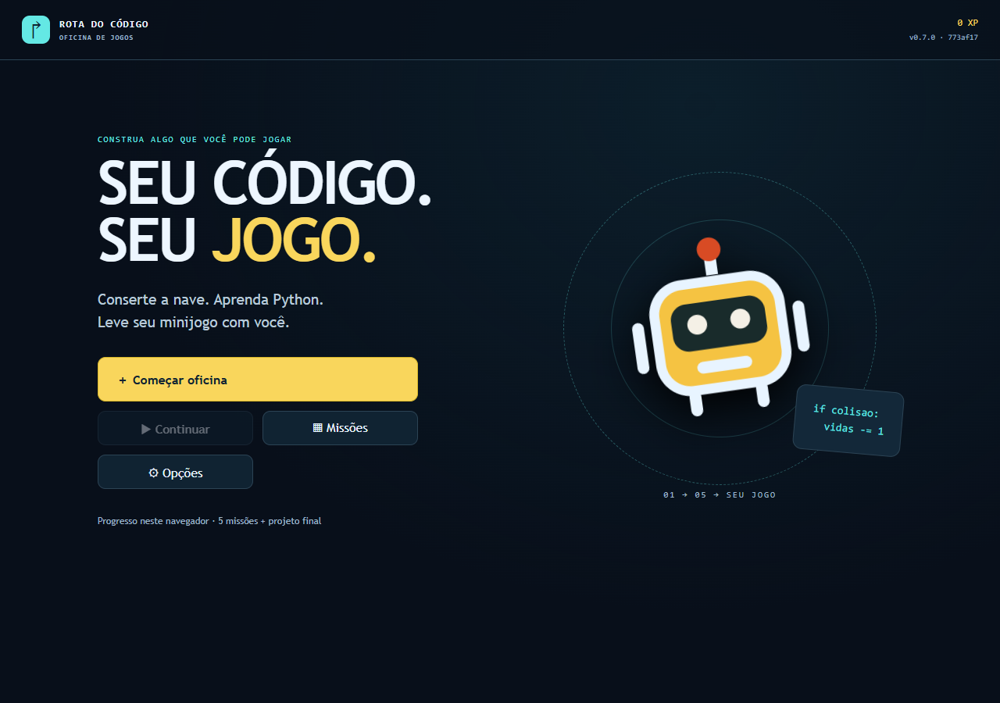
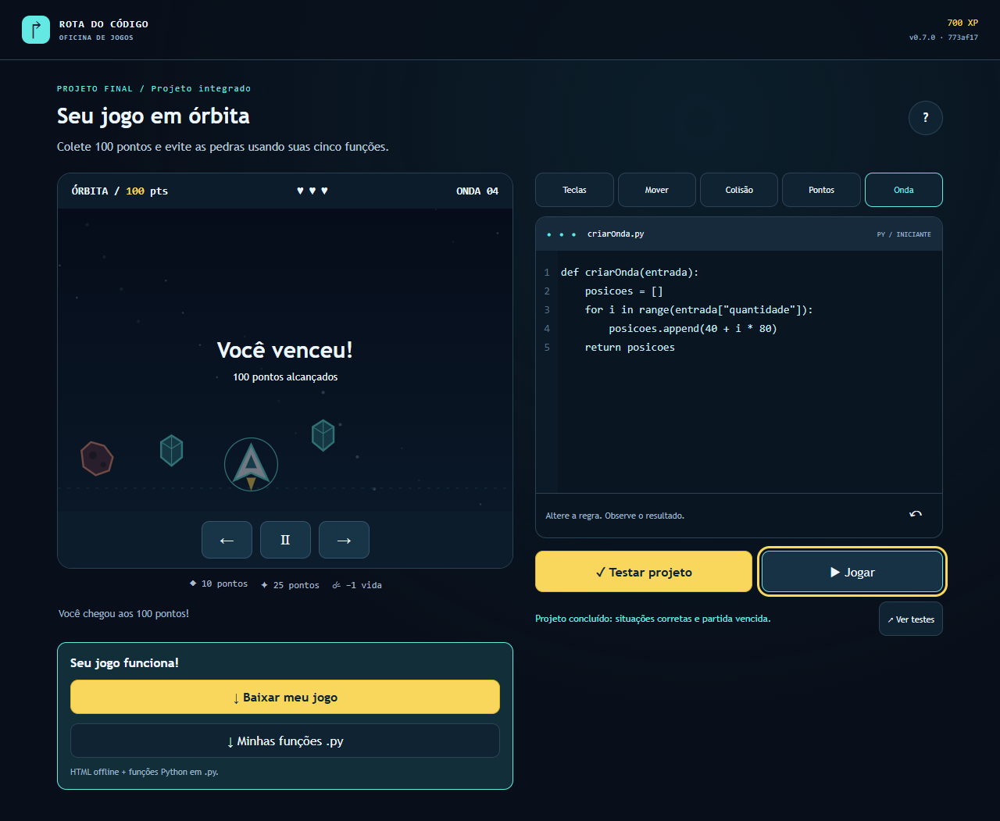

# Relatório Técnico — Desafio Arcade

**Rota do Código · Squad Aura 67 · Candidata {{VERSION}} · 15/10/2026**

## 1. Síntese, identificação e alcance

Construímos uma oficina educativa WEB em que o jogador corrige cinco funções Python, testa diferentes entradas e usa suas regras num minijogo de nave. O produto é estático, responsivo, exportável e jogável offline pelo método documentado. A avaliação de DevOps exige que esse produto atravesse Git, testes, segurança, homologação, aprovação, produção e acompanhamento com rastreabilidade.

**Repositório:** [luccalck/desafio-arcade](https://github.com/luccalck/desafio-arcade). **Estado desta revisão:** a consolidação foi integrada na main e a versão 0.7.0 chegou à HML pública. Quatro cenários públicos de regressão passaram, mas o primeiro job HML falhou ao coletar a origem temporal do push. Uma correção está no PR33, com CI aprovada e revisão humana pendente. Produção formal, recuperação e entrega acadêmica final ainda não foram comprovadas.

| Integrante | RA | Coordenação | GitHub |
|---|---|---|---|
| Lucca Castilho Costa | 26179873 | Produto e Game Design | luccalck |
| Davi Marcondes Paes de Souza | 26180842 | Desenvolvimento e Qualidade | DaviSouza78 |
| Miguel Oliveira de Almeida | 26179933 | Plataforma e Release | miguelsenai2024 |
| Lucas Souza da Silva | 26179875 | SRE e Segurança | 6lucassilvaaa |

Os papéis coordenam o trabalho, sem exclusividade de área. Preservamos a autoria dos commits; os quatro precisam defender suas contribuições na banca. O nome completo e RA de Lucca foram fornecidos pelo próprio integrante em 14/10. Não incluímos CPF, assinaturas ou credenciais.

### Marcos e fontes de referência

| Marco | Fonte verificável | Resultado e alcance |
|---|---|---|
| Auditoria 0.6.0 | [CI 38649548723](https://github.com/luccalck/desafio-arcade/actions/runs/38649548723), e71de72 | 260 testes e 36 E2E; deploys ignorados; origem histórica |
| Integração 0.7.0 | [PR32](https://github.com/luccalck/desafio-arcade/pull/32), merge 773af17 | Aprovação externa de Lucas no HEAD 59dc830; main atualizada |
| Primeira HML | [Run 38674290799](https://github.com/luccalck/desafio-arcade/actions/runs/38674290799) | CI 270/36; HML 4/4; falha na medição; PRD ignorada |
| Correção temporal | [PR33](https://github.com/luccalck/desafio-arcade/pull/33), 78c367d | CI 273/36 aprovada; revisão e integração pendentes |
| Validação pública | [HML](https://luccalck.github.io/desafio-arcade/hml/), evidências de 15/10 | 4/4 E2E, ZIP original offline e sete arquivos HTTP conferidos |

As páginas seguintes separam resultados históricos, execução atual e próximos aceites. O pitch permanece pendente por orientação de Lucca. Não há declaração de nota, fator individual, playtest humano, AVA ou banca realizados. A versão 0.7.0 é candidata técnica; não substitui o pacote acadêmico final.

<div style="break-before: page;"></div>

## 2. Produto educativo e experiência do jogador

O problema é memorizar comandos sem compreender como uma regra altera um programa. O público é iniciante em programação, com leitura básica em português e familiaridade com teclado ou toque. O objetivo é construir, testar e depurar funções que resolvem um comportamento observável, em vez de apenas seguir uma sequência de cliques.

| Missão | Conceito | Ação e condição de conclusão |
|---|---|---|
|1 — Controlar|Eventos e decisões|Corrigir direção conforme teclas; quatro casos públicos|
|2 — Mover|Operações e parâmetros|Posição + direção × velocidade; cinco casos|
|3 — Colidir|Comparação e fronteira|Distância ≤ raio, incluindo igualdade; cinco casos|
|4 — Pontuar|Estado e condições|Conservar acumulado e somar valor do item; cinco casos|
|5 — Criar onda|Lista e repetição|Quantidade exata, início 40 e intervalo 80; quatro casos|
|Final — Órbita|Integração e depuração|Aplicar cinco funções, passar 23 casos e atingir 100 pontos com três vidas|

O ciclo é editar, testar entradas, observar a partida e corrigir. Nas primeiras missões, funções auxiliares corretas isolam o conceito. O final combina as cinco fontes do jogador. Ajuda e detalhes dos testes ficam sob demanda; menus, progresso e XP organizam a campanha. Repetir missão não duplica recompensa.



**Figura 1.** HML pública capturada em 15/10/2026, 13:35:51, America/Sao_Paulo; versão 0.7.0, SHA 773af17, viewport 1280×900. Origem, horário e versão em hml-desktop-menu.json; captura produzida pelo navegador durante E2E real.

A mesma experiência WEB atende computador e celular. Teclado/toque e foco visível ajudam a navegação; o código é editável e os testes indicam a situação que falhou. A validação pública completou campanhas desktop e toque, com vitória e 700 XP, mas isso não mede aprendizagem. O playtest humano de três minutos com colega de outra turma ainda precisa observar clareza, dificuldades e transferência do conceito. Não atribuímos resultados a pessoas inexistentes.

<div style="break-before: page;"></div>

## 3. Arquitetura do jogo e funcionamento offline

A aplicação usa TypeScript, HTML/CSS/SVG e esbuild. A camada visual não decide as regras pedagógicas: o núcleo recebe entradas e devolve resultados, permitindo testar lógica e contratos sem depender da tela. O conteúdo JSON é validado antes de compilar; conteúdo inválido precisa interromper a build.

| Componente | Responsabilidade | Fronteira verificável |
|---|---|---|
|src/core|Estado, regras, compilação/interpretação e contratos|Entradas, saídas, fronteiras e limites testáveis|
|src/scenes|Menu, editor, arena, feedback e navegação|E2E por teclado/toque; regras fora da apresentação|
|src/content|Conteúdo educativo e missões|JSON validado e contratos de aprendizagem|
|pages|Carregador e contrato de rollout|Seleção de release e versão preservada na sessão|
|scripts|Build, empacotamento, publicação e observação|Contratos e falhas separados do produto|
|tests|Unidade, integração e E2E|JUnit/cobertura e artefatos por execução|

### Python pedagógico e limites

O jogador escreve funções Python dentro de um subconjunto delimitado. O analisador produz AST; o interpretador executa condições, operações, listas, atribuições e repetição limitada. Não é CPython completo: imports, classes, bibliotecas arbitrárias e acesso ao DOM/rede não fazem parte do contrato. Não usamos eval/Function para executar a fonte do jogador.

Há limites de fonte, nós, profundidade, passos e iterações. Saídas inválidas interrompem a partida com diagnóstico. Editar pausa e invalida o aceite da regra anterior; retomar exige aplicar a fonte nova. Vitória/derrota são estados finais tratados pelo motor. Esses controles reduzem falhas previsíveis sem prometer segurança absoluta de qualquer entrada.

### Exportação e alternativas técnicas

Concluir o projeto permite baixar HTML independente e funções .py. O HTML inclui motor/AST e compartilha semântica com a oficina. O arquivo .py é estudável num Python convencional; alterá-lo não recompila automaticamente o HTML exportado. Preferências/progresso ficam no navegador, sem conta ou backend. O jogador não precisa instalar Python ou engine.

| Escolha | Justificativa | Alternativa considerada e limite |
|---|---|---|
|DOM/SVG e TypeScript|Escopo pequeno, UI navegável e regras testáveis|Engine web seria válida, mas acrescentaria integração sem necessidade demonstrada|
|Subconjunto Python local|Cinco funções curtas, operação offline e sem execução remota|CPython/WASM ampliaria compatibilidade; não houve benchmark comparativo|
|Site estático Pages|Sem backend, VM ou nuvem paga; ZIP distribuível|Execução remota exigiria infraestrutura e impediria o método offline|
|Vitest/Playwright|Regras, contratos, navegador e exportação|Cobertura/contagens não substituem revisão e playtest|

O método offline é descompactar o ZIP original e abrir index.html, conforme LEIA-ME.txt. Não há API de IA em runtime, cadastro ou telemetria. Os testes offline atuais são apresentados com origem e hash na página seguinte.

<div style="break-before: page;"></div>

## 4. Proveniência, ZIP original e teste offline

A promoção precisa usar os bytes validados em HML. Recuperamos o bundle original da [run 38674290799](https://github.com/luccalck/desafio-arcade/actions/runs/38674290799), tentativa 1, SHA 773af17. O manifesto desse bundle foi verificado; a conferência da correção PR33, run 38674970174, também validou 173 arquivos por tamanho/SHA-256. Cada resultado pertence à sua origem; os pacotes não foram misturados.

**ZIP original da HML:** 29.025 bytes, SHA-256 `cedfa3b16b12e09fd77beaf9d8f9963b7341a9504bde5467ae8e19d617ba6a70`. Abaixo de 25 MB. Às 13:37:29 de 15/10, sete arquivos HTTP da HML responderam HTTP 200 com hashes iguais aos extraídos do ZIP: index.html, style.css, game.js, version.json, LEIA-ME.txt, LICENSE.txt e THIRD_PARTY.txt. Fonte: hml-zip-http.json.

O teste independente offline abriu esse ZIP já desconectado, passou cinco missões e 23 casos finais, venceu com 700 XP, baixou HTML/Python e abriu o HTML exportado. Passou 1/1 em 14,9 s; não houve requisição HTTP nem erro de página. Fonte: zip-offline.json e zip-ci-junit.xml, com origem 773af17 e horário 16:37:45,660 UTC. Esse resultado comprova o método documentado; não é uma nova build feita para a demonstração.



**Figura 2.** Captura da execução file:// do ZIP original em 15/10/2026, 13:37:45, America/Sao_Paulo; 0.7.0, SHA 773af17. A partida e a exportação foram testadas com contexto offline antes de abrir. Nenhuma interface foi desenhada para simular o resultado.

O bundle CI associa SHA/run/tentativa aos arquivos e ao manifesto. Seu verificador compara inventário, tamanho e SHA-256 e confere version.json externo contra o empacotado. Reexecuções não podem misturar tentativas. A data de origem é estável para o mesmo SHA; horários reais ficam no Actions. HML→PRD deve consumir esse pacote, sem recompilar o jogo. A igualdade HML↔ZIP está comprovada acima; a igualdade com PRD ainda depende de publicação formal.

<div style="break-before: page;"></div>

## 5. Esteira CI/CD e governança dos estágios

O fluxo mantém uma cadeia entre mudança, aprovação, artefato e versão observada. A fronteira operacional atual está na HML e na correção da coleta temporal; produção continua protegida pelo gate que falhou.

```text
branch → PR/revisão/CI → main protegida
  → build/ZIP + PDFs + SBOM/relatórios + manifesto
  → /hml/ + E2E + medição temporal
  → aprovação environment producao → release imutável
  → smoke → promoção azul-verde ou recuperação
  → sondas/Issues/status/DORA → vídeo validado → submissão/triagem
```

| Etapa | Contrato implementado | Prova exigida |
|---|---|---|
|Qualidade|npm ci, lint/tipagem, conteúdo, Vitest/cobertura|Logs, JUnit, cobertura e falha bloqueante|
|Segurança|Gitleaks, audit de produção, SBOM|Relatórios do mesmo SHA/run/tentativa|
|Build|Estático, reprodutibilidade, GDD/relatório PDF, ZIP|Version.json, checksum, pdfinfo/texto|
|E2E|Campanha, teclado/toque, exportação/offline|JUnit, capturas e arquivos reais|
|Pacote CI|Consolidar identidade e inventário|ci-manifest.json com tamanhos/hashes|
|HML/PRD|Consumir bundle sem recompilar|Recibos, aprovação, E2E/smoke e hashes HTTP|
|Submissão|Aguardar produção/release e vídeo fixado|Pacote completo e triagem real na tag correta|

Qualidade, segurança, build e E2E executam em jobs independentes de ubuntu-latest; o gate CI depende de seus resultados. Há lockfile e cache npm. GDD.pdf e RelatorioTecnico.pdf entram no bundle; pdfinfo/pdftotext verificam abertura/texto e o relatório deve ter de 1 a 12 páginas. A fonte continua versionada para revisão, sem substituir o GDD completo pelo relatório.

A consolidação corrigiu lacunas reais: relatório antes fora da CI, submissão concorrente com produção, proveniência insuficiente, seleção de vídeo pela última execução e triagem agendada sem recuperar pacote. Agora o vídeo é fixado por SHA/run/tentativa/digest, e o pacote depende de produção/release. Um HTTP200 isolado não pode substituir a validação de ZIP, PDF, vídeo e manifesto.

Azul-verde separa candidata e estável; o carregador preserva uma versão válida por sessão. Gh-pages é escrita pela pipeline, sem edição manual para contornar a falha. Environments mantêm aprovação/políticas de refs/tags. Uma aprovação de PR não substitui a de produção nem se transfere para HEAD alterado.

O PR32 recebeu revisão externa de Lucas no HEAD 59dc830 e foi integrado. O PR33 altera a medição e requer nova revisão; não autoaprovamos PRs de Lucca ou atribuímos reviews aos colegas. A autorização para publicar não elimina essa dependência real.

<div style="break-before: page;"></div>

## 6. Qualidade, testes e correção de defeitos

Os resultados pertencem ao SHA e à execução indicada. Uma suíte local/CI não comprova implantação. Mantemos regras separadas da renderização, testes de fronteira/contratos inválidos e integridade do pacote.

| Fonte | Unidade/integração | E2E | Alcance |
|---|---:|---:|---|
|[CI 38649548723](https://github.com/luccalck/desafio-arcade/actions/runs/38649548723), e71de72|260=152+108|36|Referência 0.6.0; bundle auditado|
|[Run 38674290799](https://github.com/luccalck/desafio-arcade/actions/runs/38674290799),773af17|270|36|CI 0.7.0 verde; HML depois falhou na medição|
|[CI 38674970174](https://github.com/luccalck/desafio-arcade/actions/runs/38674970174),78c367d|273|36|Push da correção PR33; sucesso|
|[CI 38674975441](https://github.com/luccalck/desafio-arcade/actions/runs/38674975441), PR33|273|36|Validação de PR, sem deploy formal|
|HML pública em 15/10, JUnit arquivado|—|4|Desktop/toque, campanha e reinício; 62,009 s|

No bundle do PR33, SHA 78c367d, ci-coverage.json mede apenas src/core: 468/478 instruções (**97,90%**), 128/128 linhas (**100%**), 54/54 funções (**100%**) e 320/336 ramificações (**95,23%**). Os JUnit confirmam 273 testes sem falhas em 2,635s e 36 E2E sem falhas em 51,081s. Supera os mínimos 15/3/2 e 70% do core, com origem remota identificada. Em 15/10, 53 testes locais de oito suítes de recuperação/alerta/monitor/DORA também passaram; são fixtures, não ensaio de produção.


**Figura 3.** HML pública em 15/10/2026, 13:36:05, America/Sao_Paulo; 0.7.0, SHA 773af17, teclado 1280×900. Metadados em hml-desktop-encerramento-real.json. A campanha mobile por toque também concluiu às 13:36:36, com capturas/vídeo próprios; são testes automatizados, não aprendizagem medida.

O bug histórico de regra antiga permitia retomar usando compilação anterior após editar. A correção invalida aceite/fingerprint e exige aplicar fonte nova; existem captura, JUnit da falha e regressão em docs/evidencias/bug-regra-antiga.md e tests/e2e/workshop.spec.mjs. [PR de contexto](https://github.com/luccalck/desafio-arcade/pull/8). O defeito temporal HML também gerou três regressões: antes 3 falhas/8 passes; depois 11 passes. Não criamos bug ou incidente fictício para atender rubrica.

<div style="break-before: page;"></div>

## 7. Homologação: falha observada e medição histórica

O [PR32](https://github.com/luccalck/desafio-arcade/pull/32) foi aprovado por Lucas (`6lucassilvaaa`) no HEAD 59dc830. O merge 773af17db29bb9fc46bfe438c0cb9c8304fbd5f5 chegou à main em 15/10/2026, 03:03:48 UTC, 00:03:48 em America/Sao_Paulo. A [run 38674290799](https://github.com/luccalck/desafio-arcade/actions/runs/38674290799) publicou HML 0.7.0 e passou os quatro cenários públicos, mas falhou ao comprovar a hora do push. PRD/release/submissão ficaram ignoradas. O gate não foi contornado.

| Prova | Resultado observado | Interpretação |
|---|---|---|
|/hml/version.json|HTTP 200; 0.7.0; SHA 773af17|Jogo integrado servido em HML|
|Regressão HML na execução|4/4 cenários aprovados|Interação pública real, distinta de E2E local|
|/rollout.json|HTTP 200; preview; SHA 71933bf; 0.6.0|Raiz ainda é preview anterior, não PRD formal 0.7.0|
|/status/|HTTP 404 na consulta preservada|Painel público ainda não comprovado|
|Medição pelo coletor original|Falha por PushEvent ausente|Job HML integral reprovado|
|Reconstrução histórica posterior|191 s, fonte PR/API e etapa E2E|Prazo histórico verificável, sem mudar o estado do job|

Um smoke real da raiz em 15/10, 13:47:20, America/Sao_Paulo, passou 1/1 em 9,7 s: conferiu ponteiro, assets, versão, redirecionamento, editor, movimento e pausa, sem erros. A fonte preview-smoke.json identifica **preview 0.6.0, SHA 71933bf**; esse resultado não é produção formal 0.7.0.

### Causa e correção proposta

O coletor dependia exclusivamente do feed público Events. A API de PR confirmava merged_at e merge_commit_sha, mas o feed não continha PushEvent durante a janela. O GitHub documenta latência de 30 segundos a 6 horas e desaconselha esse feed em casos de tempo real. [Documentação oficial](https://docs.github.com/en/rest/activity/events#list-repository-events).

A correção do [PR33](https://github.com/luccalck/desafio-arcade/pull/33) usa merged_at do PR integrado, exigindo merged=true, base main e merge_commit_sha exato. Para payload Actions, confere repositório/ref/after e repository.pushed_at, quando presente. Tags anotadas conferem objeto remoto e commit. Events passa a ser complementar. Mantemos limite 900 s e falha sem fonte válida; data de commit e criação do run não substituem publicação.

### Medição histórica, sem reclassificar a execução

O registro posterior hml-tempo-historico.json cruza o merge PR32 às 03:03:48 UTC com completed_at 03:06:59 UTC da etapa pública de regressão HML aprovada. Identidade SHA/main conferida: intervalo 191 segundos, 3 min 11 s, inferior a 900 s. As funções da correção validaram as fontes, preservadas no JSON.

Esse dado comprova o intervalo histórico observado; não torna verde o job que falhou nem substitui nova execução do coletor após revisão/merge do fix. O HEAD 78c367d tem inspeção técnica e testes concluídos, CI 273/36 verde e três regressões de contrato; a aprovação exigida de outro integrante segue pendente, sem autoaprovação. A aprovação do PR32 não cobre automaticamente a alteração PR33; a validação formal completa continua pendente.

<div style="break-before: page;"></div>

## 8. Monitoramento, alertas, DORA e recuperação

O monitor tem cron de 15 min, execução manual e persistência na branch observabilidade. Duas execuções agendadas reais passaram: [38704560758](https://github.com/luccalck/desafio-arcade/actions/runs/38704560758) e [38744110194](https://github.com/luccalck/desafio-arcade/actions/runs/38744110194). A execução manual [38770216623](https://github.com/luccalck/desafio-arcade/actions/runs/38770216623) passou durante a validação atual. Os artefatos preservam seis amostras:

|15/10 — São Paulo|Alvo|HTTP|Latência registrada|Versão|
|---|---|---:|---:|---|
|05:17:16|HML|200|0,1670 s|0.7.0|
|05:17:16|Raiz|200|0,1035 s|0.6.0|
|10:36:26|HML|200|0,1718 s|0.7.0|
|10:36:26|Raiz|200|0,0945 s|0.6.0|
|13:35:19|HML|200|0,3384 s|0.7.0|
|13:35:19|Raiz|200|0,1956 s|0.6.0|

formalHml/formalPrd=true representam flags configuradas, não certificação de deploy. A raiz segue preview 71933bf. A latência é do documento HTTP principal, incluindo consumo do corpo; não mede jornada completa ou todas as consultas de versão. Três execuções não caracterizam percentis/SLA. O intervalo de 5 h 19 min entre as agendadas não comprova cadência pontual de 15 min.

Os três arquivos alertas.json têm actions=[]. Logo, nenhuma abertura/fechamento de alerta foi observado nessas execuções. Os limiares previstos são indisponibilidade e latência>2 s, com Issues JogoForaDoAr/LatenciaAlta, idempotência e fechamento automático. Testes com adaptadores não são alertas reais.

|DORA / unidade|Definição implementada|Resultado no JSON atual|
|---|---|---|
|Frequência / deploys-dia|Produções formais bem-sucedidas ÷ dias da janela|N/D:nenhum deploy-prd formal|
|Lead time / horas|Commit até deploy-prd aceito; fonte de tempo explicitada|N/D:sem vínculo completo commit→PRD|
|Falha de mudança / %|Deploys seguidos de rollback correlacionado ÷ deploys|N/D:sem denominador formal|
|Recuperação / minutos|Abertura até fechamento de Issues de alerta|N/D:nenhuma Issue aberta/fechada|

A coleta manual usa janela 01/10/2026, 16:35:20 UTC a 15/10/2026, 16:35:20 UTC, gerada às 16:35:27,818 UTC; quatro valores null e zero amostras. A linha de base de 11 dias é fornecida no enunciado. Não há melhoria medida nem quantidade mínima inventada de dez execuções DORA.

A validação local passou 53 testes e conferiu 14 arquivos HTTP das duas baselines antigas. Não houve rollback despachado, injeção de falha ou observação contínua de produção. Revalidar tag/main do mesmo SHA não troca versão e não pode fingir recuperação. Limites separados de deploy/propagação/smoke podem exceder 5 min; ainda falta ensaio controlado com baseline saudável, relógio real, continuidade HTTP e publicação protegida.

<div style="break-before: page;"></div>

## 9. Rastreabilidade dos dez integráveis

As fontes levam a PRs ou execuções reais. A coluna final delimita o aceite completo, sem transformar testes, implementação ou flags em produção/entrega. Os documentos e artefatos locais preservam comandos, fontes, hashes e origens.

|INT / peso A|Fonte verificável|Implementado ou executado|Falta para aceite completo|
|---|---|---|---|
|INT-01 /10%|[PR #32](https://github.com/luccalck/desafio-arcade/pull/32), [PR #29](https://github.com/luccalck/desafio-arcade/pull/29)|Quatro autores/RAs; 15 reviews dos colegas e consolidação revisada/integrada|Revisão do fix, tags, conferência de contribuição e banca/F|
|INT-02 /8%|[PR #22](https://github.com/luccalck/desafio-arcade/pull/22), [CI main](https://github.com/luccalck/desafio-arcade/actions/runs/38674290799)|GDD 12 seções/Esteira, PDF automático e identificação real|Versão/data/links/direitos da release efetiva|
|INT-03 /15%|[CI/HML](https://github.com/luccalck/desafio-arcade/actions/runs/38674290799), [PR #33](https://github.com/luccalck/desafio-arcade/pull/33)|CI verde; HML publicada; 191 s históricos verificados; falha do coletor protegida|Nova HML integral verde, aprovação e PRD|
|INT-04 /12%|[CI PR33](https://github.com/luccalck/desafio-arcade/actions/runs/38674975441), [PR #8](https://github.com/luccalck/desafio-arcade/pull/8)|273 testes+36 E2E; HML 4/4; offline original 1/1; bugs/regressões|Revalidar HEAD integrado e smoke PRD formal|
|INT-05 /10%|[PR #10](https://github.com/luccalck/desafio-arcade/pull/10), [PR #32](https://github.com/luccalck/desafio-arcade/pull/32)|Scanners, SBOM, inventários, hook e governança|Direitos/licenças finais; vídeo/tag/artefatos|
|INT-06 /10%|[PR #17](https://github.com/luccalck/desafio-arcade/pull/17), [PR #23](https://github.com/luccalck/desafio-arcade/pull/23)|ZIP 29.025 B; hashes 7/7 HML; offline e proveniência|Tag/release imutável com assets e equivalência hash PRD|
|INT-07 /12%|[PR #19](https://github.com/luccalck/desafio-arcade/pull/19), [PR #21](https://github.com/luccalck/desafio-arcade/pull/21)|Loader/azul-verde/rollback preparados; HML publicada|PRD aprovada, promoção/smoke e recuperação<5 min/URL contínua|
|INT-08 /10%|[Monitor](https://github.com/luccalck/desafio-arcade/actions/runs/38770216623), [PR #23](https://github.com/luccalck/desafio-arcade/pull/23)|Duas agendadas e um manual reais; CSV/DORA; alertas sem ações|Painel/alertas reais, DORA com amostras e melhoria|
|INT-09 /8%|[PR #24](https://github.com/luccalck/desafio-arcade/pull/24), [PR #25](https://github.com/luccalck/desafio-arcade/pull/25)|Empacotamento/triagem, origem imutável e vínculo de vídeo|Pitch real, pacote e TRIAGEM APROVADA na tag final|
|INT-10 /5%|[PR #26](https://github.com/luccalck/desafio-arcade/pull/26), [PR #28](https://github.com/luccalck/desafio-arcade/pull/28)|Relatório, prints atuais datados, roteiro/legendas e divisão de banca|Pitch ≤ 90 s, provas finais, ensaio e apresentação|

### Segurança, direitos e origens das evidências

Gitleaks bloqueante no histórico, npm audit de produção, Dependabot e SBOM acompanham a CI. No bundle do PR33, ci-gitleaks.json tem zero achados e ci-npm-audit.json reporta zero vulnerabilidades, inclusive críticas. Um scanner sem achados não garante direitos ou ausência absoluta de segredo; reconferir tag,vídeo/logs e ativos finais, sem introduzir segredo real para testar detecção. LICENSE, THIRD_PARTY e AI-USAGE registram origens/usos; bibliotecas conservam suas licenças.

Os prints deste relatório vieram do navegador em HML/file:// com metadados; não são mockups Stitch. O conjunto atual possui manifesto-evidencias.json com hashes dos arquivos preservados. Docs/gestao/checklist-avaliacao.md e docs/execucao/05-pendencias-por-passo.md mantêm o inventário completo. O bundle CI fornece PDFs/JUnit/SBOM; a entrega final deve garantir retenção/acesso do professor, além de links de Actions.

<div style="break-before: page;"></div>

## 10. Colaboração, retrospectiva e fechamento

|Integrante|PRs autorais de referência|Escopo documentado|
|---|---|---|
|Lucca|[#2](https://github.com/luccalck/desafio-arcade/pull/2) a [#14](https://github.com/luccalck/desafio-arcade/pull/14), [#32](https://github.com/luccalck/desafio-arcade/pull/32)|Produto, GDD, jogo Python, CI, segurança, offline, consolidação|
|Davi|[#15](https://github.com/luccalck/desafio-arcade/pull/15) a [#19](https://github.com/luccalck/desafio-arcade/pull/19)|HML, conteúdo/testes, release, alertas, produção/painel|
|Miguel|[#20](https://github.com/luccalck/desafio-arcade/pull/20) a [#24](https://github.com/luccalck/desafio-arcade/pull/24)|Playtest preparado, recuperação, DORA, GDD, integridade/triagem|
|Lucas|[#25](https://github.com/luccalck/desafio-arcade/pull/25) a [#29](https://github.com/luccalck/desafio-arcade/pull/29)|Submissão, relatório, candidata, release/ficha/banca, revisão PR32|

Lucca declarou revisão dos colegas e autorizou 15 aprovações reais nos HEADs dos PRs 15–29; o PR32 recebeu revisão externa de Lucas. Não simulamos identidades nem autoaprovamos PRs de Lucca. Participação em três integráveis com commits/PRs aprovados e domínio na banca são requisitos individuais; a nota/fator F são atribuídos pelo professor. Estimativas 10 na ficha não são aceites de entrega.

### Retrospectiva baseada em resultados

**Funcionou:** regras separadas da UI, E2E público desktop/toque e validação do ZIP original/offline. A comparação dos sete arquivos HTTP demonstrou o artefato servido. O gate impediu produção após faltar prova temporal, embora HML publicada/regressão verde. A revisão externa e o merge protegido integraram autoria real dos quatro.

**Falhou:** registros anteciparam aceites sem eventos correspondentes; reabrimos 27 checks contestados. O coletor dependia de um feed atrasado; a execução real falhou. Cron configurado e sondas verdes não demonstram cadência pontual, painel, alertas ou DORA medido. Os 53 testes de recuperação não medem rollback/CDN real.

**Mudamos:** identificação, ficha com campos finais vazios, relatório no bundle, proveniência e ordem de submissão. PR33 adiciona fonte de merge/payload e três regressões sem aumentar 900 s. A medição histórica 191 s usa eventos reais, mas mantém o job falho identificado. **Próxima medida:** nova HML, PRD e recuperação com timestamps/HTTP contínuo; DORA antes/depois de uma melhoria; playtest humano para priorizar dificuldades observadas.

### Critérios de fechamento restantes

|Ação necessária|Evidência para concluir|
|---|---|
|Revisar/integrar PR33 e executar HML|Outro autor, CI/HML verdes e recibo temporal válido|
|Produção e recuperação|Mesmo ZIP aprovado, smoke, aprovação, relógio/URL contínua|
|Observabilidade/melhoria|Status público, alertas/fechamento, DORA com fontes e comparação|
|Pitch e playtest|Vídeo real ≤ 90 s/legendas/direitos; registro humano de 3 min|
|Tag/release/submissão|SemVer compatível, assets/manifestos, triagem real na tag final|
|Ficha, AVA, banca|TXT verdadeiro pelo HTML, recibo, ensaio e defesa dos quatro|

O pitch continua pendente por orientação de Lucca. Davi informou consentimento dos quatro e registro privado; conferir escopo/canais com o vídeo final, sem publicar documentos pessoais. A apresentação prevista é 10 min + 5 min de demonstração + 5 min de perguntas; não ocorreu nesta automação. Concurso externo é opcional, sem inscrição ou decisão coletiva comprovada. Este relatório deverá receber os resultados finais antes da entrega, preservando SHA/run/data e as falhas reais desta iteração.
